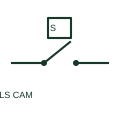

# ANSI/IEEE Cam-operated limit switch form

IEEE-library form of cam-operated limit switch: a cam-operated limit switch changes its electrical contact state when a defined cam profile reaches the actuator.

[Canonical reference](https://eloragrid.ai/symbols/ansi-cam-operated-limit-switch) · [Structured record](../entries/ansi-cam-operated-limit-switch.json) · [All references](README.md)

Updated: 2026-10-28. Drawing use: Schematic. Reference families: IEEE / ANSI, Manufacturer.

Graphical convention: IEEE / ANSI. Limit Switch Normally Open - Cam Driven.

## What it represents

This reference locates cam-operated limit switch in Autodesk's IEEE-oriented limit switches family. A cam-operated limit switch changes its electrical contact state when a defined cam profile reaches the actuator. Its position function depends on the documented cam and mechanism relationship. The public library uses HLS11S13 for its horizontal representation; this is a vendor block name, not an IEEE standards symbol number.
Read the operating mechanism and the contact reference state together. Cross-reference every associated contact to the same device and show which movement, signal or reset changes its condition; the symbol alone does not establish the complete switching sequence.
Link the cam position to the electrical contact schedule. Cam actuation is a mechanical input, not an electrically programmed timer. The linked functional counterpart explains the same operating role in its own drawing context; agreement of every detailed convention mark is not asserted.

## How to read it

- Link the cam position to the electrical contact schedule.
- The preview is an original explanation of this function. Match the actual drawing convention to its legend and the selected equipment documentation.

## Drawing checklist

- Reference cam detail
- Identify operated contact
- State normal mechanism position

## Important distinction

Cam actuation is a mechanical input, not an electrically programmed timer.

## Facts

- Convention evidence: Autodesk IEEE Symbol Preview: Limit Switches; published form: Limit Switch Normally Open - Cam Driven.
- Public vendor block: HLS11S13. Vendor library token, not an IEEE symbol number.
- Drawing role: Actuated indication
- Identifier status: The short label is a functional lookup label, not an assigned IEC or IEEE symbol number. Any separately listed Autodesk code is a verified vendor block name.
- Artwork scope: Original educational geometry. Exact standard graphics, product ratings and terminal pinouts are not certified.

## Public references

- [Autodesk IEEE Symbol Preview — Limit Switches](https://help.autodesk.com/cloudhelp/2021/ENU/AutoCAD-Electrical/files/GUID-C0135D6B-F4A5-4954-85E0-5B188E5FF5C9.htm) — Autodesk. Public IEEE-oriented Limit Switches table explicitly lists HLS11S13 as Limit Switch Normally Open - Cam Driven. This supports the vendor convention context, not reproduction of the publisher graphic.

## Related references

- [Cam-operated limit switch](cam-operated-limit-switch.md)
- [PLC input / output](plc-io.md)
- [Normally open contact](normally-open-contact.md)

Original educational concept geometry, CC BY 4.0. Unitless; not a certified standards glyph or manufacturer footprint.

Elora-authored explanations are CC BY 4.0. Linked standards and manufacturer material retain their own rights. Confirm project requirements using primary sources.
