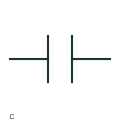

# ANSI/IEEE capacitor symbol

IEEE-oriented graphical reference for capacitor, with public vendor evidence and drawing-reading notes.

[Canonical reference](https://eloragrid.ai/symbols/ansi-capacitor) · [Structured record](../entries/ansi-capacitor.json) · [All references](README.md)

Updated: 2026-10-27. Drawing use: SLD, Schematic. Reference families: IEEE / ANSI, Manufacturer.

Graphical convention: IEEE / ANSI. Autodesk IEEE-oriented Capacitive Components functional form.

## What it represents

The capacitor form identifies a capacitive component between its circuit connections. Its value and voltage rating are read from the component annotation, and the circuit placement establishes whether its role is filtering, coupling or another documented function.
This is a convention-specific lookup based on the publisher's IEEE-labelled preview. The geometry here is independently drawn to explain the connection or operation; it is not a certified reproduction of the standard graphic.

## How to read it

- The two plates represent a function, not a physical spacing dimension.
- Read the selected library and the project legend together. A vendor block identifier is meaningful within its named library and is not a universal standard-symbol code.

## Drawing checklist

- State capacitance/tolerance
- Record voltage rating
- Identify circuit purpose

## Important distinction

A generic capacitor form does not establish polarisation or an electrolytic construction.

## Facts

- Convention evidence: Autodesk IEEE Symbol Preview — Capacitive Components
- Public vendor block name: HCA1 (Autodesk identifier; not an IEEE symbol number)
- Standards context: IEEE/ANSI 315-1975 covers diagram graphics. IEEE lists this edition as Inactive-Reserved.
- Artwork scope: Original functional illustration; exact standard glyph and compliance are not certified

## Public references

- [Autodesk IEEE Symbol Preview — Capacitive Components](https://help.autodesk.com/cloudhelp/2021/ENU/AutoCAD-Electrical/files/GUID-0F8673C7-D786-441C-AB55-F2CDB8D5B288.htm) — Autodesk. Exact public IEEE-oriented category page verifying the component name and vendor block identifier.
- [IEEE/ANSI 315-1975: graphic symbols for electrical and electronics diagrams](https://standards.ieee.org/ieee/315/515/) — IEEE Standards Association. Graphic-symbol standards context and official status; not a source of reproduced artwork.

## Related references

- [Capacitor](capacitor.md)
- [Busbar](busbar.md)
- [Circuit breaker](circuit-breaker.md)
- [Resistor](resistor.md)

Original educational concept geometry, CC BY 4.0. Unitless; not a certified standards glyph or manufacturer footprint.

Elora-authored explanations are CC BY 4.0. Linked standards and manufacturer material retain their own rights. Confirm project requirements using primary sources.
