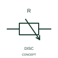

# ANSI/IEEE Carbon-disc variable resistor form

IEEE-library form of carbon-disc variable resistor: this representation identifies the publisher's carbon-disc variable-resistance form.

[Canonical reference](https://eloragrid.ai/symbols/ansi-carbon-disc-variable-resistor) · [Structured record](../entries/ansi-carbon-disc-variable-resistor.json) · [All references](README.md)

Updated: 2026-10-28. Drawing use: Schematic. Reference families: IEEE / ANSI, Manufacturer.

Graphical convention: IEEE / ANSI. Variable Resistor with Carbon Disks.

## What it represents

This reference locates carbon-disc variable resistor in Autodesk's IEEE-oriented resistive components family. This representation identifies the publisher's carbon-disc variable-resistance form. The publisher identifies a variable resistive form using carbon discs as part of its operating construction. That identifies a component principle without assigning a resistance law or power rating. The public library uses HVR1R8 for its horizontal representation; this is a vendor block name, not an IEEE standards symbol number.
Follow the actual current path and terminal polarity in the surrounding circuit. The symbol identifies an electrical function; voltage, current, energy limits and the device package pinout come from the selected component data rather than from the outline.
Document the actual control mechanism and terminal arrangement where the device appears in a legacy circuit. It should not be silently replaced with a potentiometer having a different connection and operating behaviour. State the resistance-control mechanism and associated terminals in the equipment description. The material/mechanism indication is distinct from a generic electronic potentiometer. The linked functional counterpart explains the same operating role in its own drawing context; agreement of every detailed convention mark is not asserted.

## How to read it

- State the resistance-control mechanism and associated terminals in the equipment description.
- The material/mechanism indication is distinct from a generic electronic potentiometer.

## Drawing checklist

- Identify the associated device, circuit or diagram boundary.
- State the resistance-control mechanism and associated terminals in the equipment description.
- Cross-reference the equipment data, terminal mapping or operating-state legend needed to interpret the form.

## Important distinction

The material/mechanism indication is distinct from a generic electronic potentiometer.

## Facts

- Convention evidence: Autodesk IEEE Symbol Preview: Resistive Components; published form: Variable Resistor with Carbon Disks.
- Public vendor block: HVR1R8. Vendor library token, not an IEEE symbol number.
- Information added: State the resistance-control mechanism and associated terminals in the equipment description.
- Preview: Independent educational concept; consult the publisher and applicable standard for the exact graphic
- Artwork scope: Original educational geometry. Exact standard graphics, product ratings and terminal pinouts are not certified.

## Public references

- [Autodesk IEEE Symbol Preview — Resistive Components](https://help.autodesk.com/cloudhelp/2021/ENU/AutoCAD-Electrical/files/GUID-1A45DE3A-CD2A-4AD9-8125-219905C870B1.htm) — Autodesk. Public IEEE-oriented Resistive Components table explicitly lists HVR1R8 as Variable Resistor with Carbon Disks. This supports the vendor convention context, not reproduction of the publisher graphic.

## Related references

- [Carbon-disc variable resistor](iec-carbon-disc-variable-resistor.md)
- [Resistor](resistor.md)
- [Capacitor](capacitor.md)

Original educational concept geometry, CC BY 4.0. Unitless; not a certified standards glyph or manufacturer footprint.

Elora-authored explanations are CC BY 4.0. Linked standards and manufacturer material retain their own rights. Confirm project requirements using primary sources.
