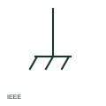

# ANSI/IEEE chassis ground symbol

IEEE-oriented chassis or frame ground drawn as a line ending in angled strokes, used for equipment frame returns.

[Canonical reference](https://eloragrid.ai/symbols/ansi-chassis-ground) · [Structured record](../entries/ansi-chassis-ground.json) · [All references](README.md)

Updated: 2026-10-28. Drawing use: Schematic. Reference families: IEEE / ANSI.

Graphical convention: IEEE / ANSI. Chassis ground form.

## What it represents

US-practice electronics and control schematics show chassis ground as a line ending in a horizontal bar with angled strokes beneath it. It identifies a connection to the equipment frame and is often used for screen terminations and filter returns inside an enclosure.
This illustration is an independent explanation, not the IEEE graphic. As with the IEC frame connection, chassis ground is not proof that the frame is connected to earth ground. Safety grounding should be shown with the protective ground symbol.

## How to read it

- Do not treat chassis ground as earth ground without a separate bond.
- Look for screen terminations on chassis grounds.

## Drawing checklist

- Show the bond between chassis and earth ground.
- Keep chassis and signal commons distinct.
- Identify chassis stud locations.

## Important distinction

Chassis ground ties to the frame; earth ground ties to the grounding electrode system.

## Facts

- Convention evidence: IEEE 315 graphic conventions for chassis or frame connection (standards context only)
- Standards context: IEEE/ANSI 315-1975 covers diagram graphics; IEEE lists this edition as Inactive-Reserved.
- Preview: Original educational illustration; consult the publisher and applicable standard for the exact graphic

## Public references

- [IEEE/ANSI 315-1975: graphic symbols for electrical and electronics diagrams](https://standards.ieee.org/ieee/315/515/) — IEEE Standards Association. Graphic-symbol standards context and official status; not a source of reproduced artwork.
- [Autodesk IEEE Symbol Preview — Miscellaneous](https://help.autodesk.com/cloudhelp/2021/ENU/AutoCAD-Electrical/files/GUID-34282BFD-7B8E-48F3-A6ED-93ADBDDDFBD3.htm) — Autodesk. Public IEEE-oriented earth and ground forms.

## Related references

- [Frame or chassis connection](iec-frame-or-chassis-connection.md)
- [ANSI/IEEE protective earth symbol](ansi-protective-earth.md)
- [ANSI/IEEE earth connection symbol](ansi-earth-connection.md)

Original educational concept geometry, CC BY 4.0. Unitless; not a certified standards glyph or manufacturer footprint.

Elora-authored explanations are CC BY 4.0. Linked standards and manufacturer material retain their own rights. Confirm project requirements using primary sources.
