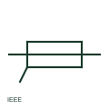

# ANSI/IEEE coaxial cable symbol

IEEE-oriented coaxial cable drawn as a centre conductor with a surrounding outer conductor that terminates at each end.

[Canonical reference](https://eloragrid.ai/symbols/ansi-coaxial-cable) · [Structured record](../entries/ansi-coaxial-cable.json) · [All references](README.md)

Updated: 2026-10-28. Drawing use: Schematic. Reference families: IEEE / ANSI.

Graphical convention: IEEE / ANSI. Coaxial cable with outer conductor outline.

## What it represents

IEEE-oriented drawings represent coaxial cable with a centre line enclosed by an outer conductor outline, often with the outer conductor brought out to a ground or connector shell at the ends. The convention is used on communications, metering time-sync and RF schematics in US-practice drawing sets.
This illustration explains the idea and is not a certified IEEE graphic. The cable impedance and connector types must still be given in text. Where the outer conductor is grounded at both ends between buildings, check for ground loop and surge transfer issues.

## How to read it

- Read connector and impedance notes at each end.
- Check outer conductor grounding at building entries.

## Drawing checklist

- State cable type or impedance.
- Name connectors at each end.
- Show outer conductor grounding.

## Important distinction

The ANSI coaxial form has a current-carrying outer conductor; the ANSI shielded conductor form has a screen only.

## Facts

- Convention evidence: IEEE 315 graphic conventions for coaxial cable (standards context only)
- Standards context: IEEE/ANSI 315-1975 covers diagram graphics; IEEE lists this edition as Inactive-Reserved.
- Preview: Original educational illustration; consult the publisher and applicable standard for the exact graphic

## Public references

- [IEEE/ANSI 315-1975: graphic symbols for electrical and electronics diagrams](https://standards.ieee.org/ieee/315/515/) — IEEE Standards Association. Graphic-symbol standards context and official status; not a source of reproduced artwork.
- [Autodesk IEEE Symbol Preview — Connectors - No Wirenumber Changes](https://help.autodesk.com/cloudhelp/2021/ENU/AutoCAD-Electrical/files/GUID-0B14FEAB-110A-4DD3-884E-0A2F8F9E76F7.htm) — Autodesk. Public IEEE-oriented connector forms used at coax ends.

## Related references

- [Coaxial cable](iec-coaxial-cable.md)
- [ANSI/IEEE shielded conductor symbol](ansi-shielded-conductor.md)
- [ANSI/IEEE coaxial connector symbol](ansi-coaxial-connector.md)

Original educational concept geometry, CC BY 4.0. Unitless; not a certified standards glyph or manufacturer footprint.

Elora-authored explanations are CC BY 4.0. Linked standards and manufacturer material retain their own rights. Confirm project requirements using primary sources.
