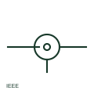

# ANSI/IEEE coaxial connector symbol

IEEE-oriented coaxial connector symbol showing mating centre and outer contacts for a coaxial cable.

[Canonical reference](https://eloragrid.ai/symbols/ansi-coaxial-connector) · [Structured record](../entries/ansi-coaxial-connector.json) · [All references](README.md)

Updated: 2026-10-28. Drawing use: Schematic. Reference families: IEEE / ANSI.

Graphical convention: IEEE / ANSI. Coaxial connector form.

## What it represents

IEEE-style schematics show a coaxial connector as a centre contact within an outer shell outline, often with the shell tied to ground. US-practice drawings label coaxial jacks with J reference designators and plugs with P, following IEEE reference designation practice.
This is an independently drawn explanation, not the IEEE graphic. Connector series and impedance must still be given. Where the shell is grounded at the panel, the outer conductor of the cable is grounded there too, which affects ground loop analysis.

## How to read it

- Read J or P designations to identify jack or plug.
- Check shell grounding at the panel.

## Drawing checklist

- State connector series and impedance.
- Use J and P designators consistently.
- Show shell grounding.

## Important distinction

An ANSI coaxial connector mates concentric contacts; the ANSI plug and socket pair mates single conductors.

## Facts

- Convention evidence: IEEE 315 graphic conventions for coaxial connectors (standards context only)
- Standards context: IEEE/ANSI 315-1975 covers diagram graphics; IEEE lists this edition as Inactive-Reserved.
- Preview: Original educational illustration; consult the publisher and applicable standard for the exact graphic

## Public references

- [IEEE/ANSI 315-1975: graphic symbols for electrical and electronics diagrams](https://standards.ieee.org/ieee/315/515/) — IEEE Standards Association. Graphic-symbol standards context and official status; not a source of reproduced artwork.
- [Autodesk IEEE Symbol Preview — Connectors - No Wirenumber Changes](https://help.autodesk.com/cloudhelp/2021/ENU/AutoCAD-Electrical/files/GUID-0B14FEAB-110A-4DD3-884E-0A2F8F9E76F7.htm) — Autodesk. Public IEEE-oriented preview of connector forms.

## Related references

- [Coaxial plug and socket](iec-coaxial-plug-and-socket.md)
- [ANSI/IEEE coaxial cable symbol](ansi-coaxial-cable.md)
- [ANSI/IEEE plug and socket connector pair symbol](ansi-plug-and-socket-connector-pair.md)

Original educational concept geometry, CC BY 4.0. Unitless; not a certified standards glyph or manufacturer footprint.

Elora-authored explanations are CC BY 4.0. Linked standards and manufacturer material retain their own rights. Confirm project requirements using primary sources.
