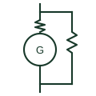

# ANSI/IEEE compound-excited DC generator symbol

IEEE-oriented library form of a DC generator with both series and shunt field windings, for drawing lookup.

[Canonical reference](https://eloragrid.ai/symbols/ansi-compound-excited-dc-generator) · [Structured record](../entries/ansi-compound-excited-dc-generator.json) · [All references](README.md)

Updated: 2026-10-28. Drawing use: Schematic. Reference families: IEEE / ANSI, Manufacturer.

Graphical convention: IEEE / ANSI. Autodesk IEEE-oriented DC Generator with Compound Excitation functional form.

## What it represents

A compound-excited DC generator combines a shunt field across the armature with a series field carrying load current. Depending on whether the series field aids or opposes the shunt field, terminal voltage can stay nearly flat, rise or fall with load. Such machines survive in legacy battery charging, traction and test installations.
IEEE-style schematics draw the armature circle with brushes, the series field as a winding in the armature lead and the shunt field as a separate winding across the terminals. This entry is a convention-specific lookup based on a publisher's IEEE-labelled preview; the geometry here is independently drawn and is not a certified reproduction of the standard graphic.

## How to read it

- Identify whether the shunt field is connected across the armature only (short shunt) or across the series field as well (long shunt).
- The vendor block identifier is a library name, not a standard number.

## Drawing checklist

- State field connection: short or long shunt, cumulative or differential.
- Show field rheostat if fitted.
- Cross-reference the IEC-style counterpart entry.

## Important distinction

A compound generator has both series and shunt fields; a plain DC generator symbol does not specify the field arrangement.

## Facts

- Convention evidence: Autodesk IEEE Symbol Preview, Generators
- Public vendor block name: HPW1G10, VPW1G10 (Autodesk identifiers; not IEEE symbol numbers)
- Field windings: Series and shunt
- Artwork scope: Original functional illustration; exact standard glyph and compliance are not certified

## Public references

- [Autodesk IEEE Symbol Preview — Generators](https://help.autodesk.com/cloudhelp/2021/ENU/AutoCAD-Electrical/files/GUID-6A9FA93B-3010-4274-AE51-20DB3520999C.htm) — Autodesk. Public IEEE-oriented generator category page listing the compound-excitation DC generator block.
- [IEEE/ANSI 315-1975: graphic symbols for electrical and electronics diagrams](https://standards.ieee.org/ieee/315/515/) — IEEE Standards Association. Graphic-symbol standards context; not a source of reproduced artwork.

## Related references

- [Compound-excited DC generator](compound-excited-dc-generator.md)
- [ANSI/IEEE dc generator symbol](ansi-dc-generator.md)
- [DC generator](dc-generator.md)

Original educational concept geometry, CC BY 4.0. Unitless; not a certified standards glyph or manufacturer footprint.

Elora-authored explanations are CC BY 4.0. Linked standards and manufacturer material retain their own rights. Confirm project requirements using primary sources.
