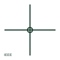

# ANSI/IEEE conductor junction symbol

IEEE-oriented junction dot marking a connection between crossing or meeting conductors on an ANSI-style schematic.

[Canonical reference](https://eloragrid.ai/symbols/ansi-conductor-junction) · [Structured record](../entries/ansi-conductor-junction.json) · [All references](README.md)

Updated: 2026-10-28. Drawing use: Schematic, SLD. Reference families: IEEE / ANSI.

Graphical convention: IEEE / ANSI. Solid junction dot.

## What it represents

In ANSI-style schematics a solid dot at the meeting of conductors indicates an electrical connection. Unlike some IEC practice, readers in this convention often treat any crossing without a dot as not connected and expect a dot even on tees, so the dot carries more weight than it does on IEC drawings.
This is a convention-specific lookup. The geometry here is independently drawn to explain the connection; it is not a certified reproduction of the IEEE graphic. The dot only states continuity; the physical joint may be a terminal, lug or splice elsewhere.

## How to read it

- Read any undotted crossing as unconnected unless the legend says otherwise.
- Confirm the physical connection point on the wiring diagram.

## Drawing checklist

- Place a dot at every intended connection.
- Avoid dots on crossings that are not connected.
- Keep the dot size legible after reduction.

## Important distinction

The junction dot shows connection; the ANSI crossing hop shows deliberately unconnected conductors.

## Facts

- Convention evidence: Wire connection dot display in AutoCAD Electrical public guidance
- Standards context: IEEE/ANSI 315-1975 covers diagram graphics; IEEE lists this edition as Inactive-Reserved.
- Preview: Original educational illustration; consult the publisher and applicable standard for the exact graphic

## Public references

- [Wire connection dots, crossing gaps and loops](https://help.autodesk.com/cloudhelp/2020/ENU/AutoCAD-Electrical/files/GUID-936BB8A9-9C01-4AC6-B833-CB97700A7203.htm) — Autodesk. Public guidance on connection dots, crossing gaps and loops.
- [IEEE/ANSI 315-1975: graphic symbols for electrical and electronics diagrams](https://standards.ieee.org/ieee/315/515/) — IEEE Standards Association. Graphic-symbol standards context and official status; not a source of reproduced artwork.

## Related references

- [Conductor connection junction](iec-conductor-connection-junction.md)
- [ANSI/IEEE crossing conductor hop symbol](ansi-crossing-conductor-hop.md)
- [ANSI/IEEE wire splice symbol](ansi-wire-splice.md)

Original educational concept geometry, CC BY 4.0. Unitless; not a certified standards glyph or manufacturer footprint.

Elora-authored explanations are CC BY 4.0. Linked standards and manufacturer material retain their own rights. Confirm project requirements using primary sources.
