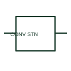

# ANSI/IEEE Converter substation form

IEEE-library reference for converter substation, with its operating meaning, connection notes and public vendor block identity.

[Canonical reference](https://eloragrid.ai/symbols/ansi-converter-substation) · [Structured record](../entries/ansi-converter-substation.json) · [All references](README.md)

Updated: 2026-10-28. Drawing use: SLD, Schematic. Reference families: IEEE / ANSI, Manufacturer.

Graphical convention: IEEE / ANSI. Converting Substation, In Service Or Unspecified.

## What it represents

This reference locates converter substation in Autodesk's IEEE-oriented power stations family. A converter-substation representation identifies a documented facility where an electrical conversion function forms part of the network connection. Its actual conversion equipment and AC/DC boundaries require linked design drawings. The public library uses HDV1\_S00406 for its horizontal representation; this is a vendor block name, not an IEEE standards symbol number.
Use the surrounding circuit labels and the project legend to identify the intended operating condition and connection. Carry the same device reference into the schedule or equipment document so the symbol can be reconciled with its real terminals, function and operating limits.
Identify which network quantities or interfaces the station converts. A converter station is a system-level facility, not a single generic converter component. The linked functional counterpart explains the same operating role in its own drawing context; agreement of every detailed convention mark is not asserted.

## How to read it

- Identify which network quantities or interfaces the station converts.
- The preview is an original explanation of this function. Match the actual drawing convention to its legend and the selected equipment documentation.

## Drawing checklist

- Name station boundary
- Show AC/DC interface labels
- Reference conversion SLD

## Important distinction

A converter station is a system-level facility, not a single generic converter component.

## Facts

- Convention evidence: Autodesk IEEE Symbol Preview: Power Stations; published form: Converting Substation, In Service Or Unspecified.
- Public vendor block: HDV1\_S00406. Vendor library token, not an IEEE symbol number.
- Drawing role: Supply or network role
- Identifier status: The short label is a functional lookup label, not an assigned IEC or IEEE symbol number. Any separately listed Autodesk code is a verified vendor block name.
- Artwork scope: Original educational geometry. Exact standard graphics, product ratings and terminal pinouts are not certified.

## Public references

- [Autodesk IEEE Symbol Preview: Power Stations](https://help.autodesk.com/cloudhelp/2021/ENU/AutoCAD-Electrical/files/GUID-002D3D7C-C3E9-4B60-9F6D-FFBB383C1862.htm) — Autodesk. Public IEEE-oriented Power Stations table explicitly lists HDV1\_S00406 as Converting Substation, In Service Or Unspecified. This supports the vendor convention context, not reproduction of the publisher graphic.

## Related references

- [Converter substation](converter-substation.md)
- [Generator](generator.md)
- [Busbar](busbar.md)

Original educational concept geometry, CC BY 4.0. Unitless; not a certified standards glyph or manufacturer footprint.

Elora-authored explanations are CC BY 4.0. Linked standards and manufacturer material retain their own rights. Confirm project requirements using primary sources.
