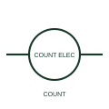

# ANSI/IEEE Counter relay with electrical reset form

IEEE-library form of counter relay with electrical reset: an electrically reset counter relay has a separate reset command or documented electronic reset mechanism.

[Canonical reference](https://eloragrid.ai/symbols/ansi-counter-relay-with-electrical-reset) · [Structured record](../entries/ansi-counter-relay-with-electrical-reset.json) · [All references](README.md)

Updated: 2026-10-28. Drawing use: Schematic. Reference families: IEEE / ANSI, Manufacturer.

Graphical convention: IEEE / ANSI. Counter Electronic Reset.

## What it represents

This reference locates counter relay with electrical reset in Autodesk's IEEE-oriented counter relays family. An electrically reset counter relay has a separate reset command or documented electronic reset mechanism. Schematics need the count and reset paths to remain distinct. The public library uses HCR1CNE for its horizontal representation; this is a vendor block name, not an IEEE standards symbol number.
Trace the measured quantity or initiating control signal separately from the output contacts. The device tag links the sensing or operating element to the controlled circuit; settings, reset behaviour and the actual terminal arrangement belong in the selected equipment documentation.
Establish reset priority where count and reset signals can occur together. Electrical reset changes the counter state; it is not the same as disconnecting the measured circuit. The linked functional counterpart explains the same operating role in its own drawing context; agreement of every detailed convention mark is not asserted.

## How to read it

- Establish reset priority where count and reset signals can occur together.
- The preview is an original explanation of this function. Match the actual drawing convention to its legend and the selected equipment documentation.

## Drawing checklist

- Identify count terminal
- Identify reset terminal
- Reference output and reset sequence

## Important distinction

Electrical reset changes the counter state; it is not the same as disconnecting the measured circuit.

## Facts

- Convention evidence: Autodesk IEEE Symbol Preview: Counter Relays; published form: Counter Electronic Reset.
- Public vendor block: HCR1CNE. Vendor library token, not an IEEE symbol number.
- Drawing role: Relay operation
- Identifier status: The short label is a functional lookup label, not an assigned IEC or IEEE symbol number. Any separately listed Autodesk code is a verified vendor block name.
- Artwork scope: Original educational geometry. Exact standard graphics, product ratings and terminal pinouts are not certified.

## Public references

- [Autodesk IEEE Symbol Preview: Counter Relays](https://help.autodesk.com/cloudhelp/2021/ENU/AutoCAD-Electrical/files/GUID-6A79079B-1B7A-45B5-9B28-CA7893CFF46F.htm) — Autodesk. Public IEEE-oriented Counter Relays table explicitly lists HCR1CNE as Counter Electronic Reset. This supports the vendor convention context, not reproduction of the publisher graphic.

## Related references

- [Counter relay with electrical reset](counter-relay-with-electrical-reset.md)
- [Relay coil](relay-coil.md)
- [Normally open contact](normally-open-contact.md)

Original educational concept geometry, CC BY 4.0. Unitless; not a certified standards glyph or manufacturer footprint.

Elora-authored explanations are CC BY 4.0. Linked standards and manufacturer material retain their own rights. Confirm project requirements using primary sources.
