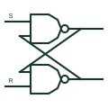

# ANSI cross-coupled NAND latch

Two NAND gates with outputs fed back to each other, forming an SR latch with active-low set and reset.

[Canonical reference](https://eloragrid.ai/symbols/ansi-cross-coupled-nand-latch) · [Structured record](../entries/ansi-cross-coupled-nand-latch.json) · [All references](README.md)

Updated: 2026-10-28. Drawing use: Schematic. Reference families: IEEE / ANSI, Manufacturer.

Graphical convention: IEEE / ANSI. Two NAND outlines with each output fed back to the other gate's input.

## What it represents

Drawing the latch as two cross-coupled NAND gates shows its construction explicitly. A low on the set input forces Q high; a low on the reset input forces the complement high. With both inputs high the latch holds. Both inputs low drives both outputs high, which is normally treated as invalid.
This drawing form is common in teaching material, switch debounce circuits and older schematics where the latch is built from a quad NAND package. It lets a reviewer see the feedback paths and the pins used.
Because the latch is built from gates, the drawing shows nothing about which state it adopts at power-up. If a defined state is needed, a reset pulse or a pull network must be shown.

## How to read it

- Inputs are active low.
- Both inputs low gives both outputs high and is usually avoided.

## Drawing checklist

- Draw the feedback paths clearly without ambiguous crossings.
- Mark inputs as active low in the net names.
- Show any power-up reset arrangement.

## Important distinction

The cross-coupled NOR latch has active-high inputs.

## Facts

- Input sense: Active low
- Invalid state: Both inputs low
- Artwork scope: Original educational illustration; consult the applicable standard and the selected device documentation for the exact graphic

## Public references

- [SN74HC00 — NAND gate logic](https://www.ti.com/lit/ds/symlink/sn74hc00.pdf) — Texas Instruments. NAND gate documentation for the building block.
- [SN74LS279A — set-reset latches](https://www.ti.com/product/SN74LS279A) — Texas Instruments. SR latch device documentation.

## Related references

- [Set-reset latch](set-reset-latch.md)
- [ANSI cross-coupled NOR latch](ansi-cross-coupled-nor-latch.md)
- [IEC SR latch (rectangular form)](iec-sr-latch.md)

Original educational concept geometry, CC BY 4.0. Unitless; not a certified standards glyph or manufacturer footprint.

Elora-authored explanations are CC BY 4.0. Linked standards and manufacturer material retain their own rights. Confirm project requirements using primary sources.
