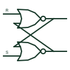

# ANSI cross-coupled NOR latch

Two NOR gates cross-coupled to form an SR latch with active-high set and reset inputs.

[Canonical reference](https://eloragrid.ai/symbols/ansi-cross-coupled-nor-latch) · [Structured record](../entries/ansi-cross-coupled-nor-latch.json) · [All references](README.md)

Updated: 2026-10-28. Drawing use: Schematic. Reference families: IEEE / ANSI, Manufacturer.

Graphical convention: IEEE / ANSI. Two NOR outlines with each output fed back to the other gate's input.

## What it represents

Two NOR gates with each output fed back to an input of the other form an SR latch with active-high inputs. A high on set drives Q high, a high on reset drives Q low, and both low holds the state. Both high forces both outputs low and is normally treated as invalid.
This form appears in educational schematics and in discrete logic designs where a spare quad NOR package provides a latch. It is the natural form when the set and reset signals are active-high commands.
Like the NAND form, it shows construction rather than a guaranteed power-up state. A defined start-up condition needs extra circuitry or a reset pulse.

## How to read it

- Inputs are active high.
- Both inputs high gives both outputs low.

## Drawing checklist

- Draw feedback paths clearly.
- Identify which output is Q.
- Show the power-up reset arrangement if needed.

## Important distinction

The cross-coupled NAND latch responds to active-low inputs.

## Facts

- Input sense: Active high
- Invalid state: Both inputs high
- Artwork scope: Original educational illustration; consult the applicable standard and the selected device documentation for the exact graphic

## Public references

- [SN74HC02 — NOR gate logic](https://www.ti.com/lit/ds/symlink/sn74hc02.pdf) — Texas Instruments. NOR gate documentation for the building block.

## Related references

- [Set-reset latch](set-reset-latch.md)
- [ANSI cross-coupled NAND latch](ansi-cross-coupled-nand-latch.md)
- [IEC SR latch (rectangular form)](iec-sr-latch.md)

Original educational concept geometry, CC BY 4.0. Unitless; not a certified standards glyph or manufacturer footprint.

Elora-authored explanations are CC BY 4.0. Linked standards and manufacturer material retain their own rights. Confirm project requirements using primary sources.
