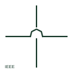

# ANSI/IEEE crossing conductor hop symbol

IEEE-oriented hop or loop drawn where one conductor passes over another without connecting.

[Canonical reference](https://eloragrid.ai/symbols/ansi-crossing-conductor-hop) · [Structured record](../entries/ansi-crossing-conductor-hop.json) · [All references](README.md)

Updated: 2026-10-28. Drawing use: Schematic. Reference families: IEEE / ANSI.

Graphical convention: IEEE / ANSI. Crossing hop form.

## What it represents

Older ANSI-style schematics often draw a small semicircular hop where one conductor crosses another, removing any doubt that the two are unconnected. Many CAD packages offer the hop, a gap or a plain crossing as display options, and the choice is set per drawing set.
The hop carries no physical meaning; it is a reading aid. This illustration is an independent explanation of the convention rather than a reproduction of the IEEE graphic. Where a drawing set mixes hops and plain crossings, check the legend rather than assuming that plain crossings are connected.

## How to read it

- Treat the hop as no connection.
- Check whether the drawing set also uses plain crossings.

## Drawing checklist

- Use one crossing display style per drawing set.
- Never place a junction dot on a hop.
- State the crossing convention in the legend.

## Important distinction

A hop is an unconnected crossing; a junction dot is a connection.

## Facts

- Convention evidence: Wire crossing loop display in AutoCAD Electrical public guidance
- Standards context: IEEE/ANSI 315-1975 covers diagram graphics; IEEE lists this edition as Inactive-Reserved.
- Preview: Original educational illustration; consult the publisher and applicable standard for the exact graphic

## Public references

- [Wire connection dots, crossing gaps and loops](https://help.autodesk.com/cloudhelp/2020/ENU/AutoCAD-Electrical/files/GUID-936BB8A9-9C01-4AC6-B833-CB97700A7203.htm) — Autodesk. Public guidance on crossing gaps and loops.
- [IEEE/ANSI 315-1975: graphic symbols for electrical and electronics diagrams](https://standards.ieee.org/ieee/315/515/) — IEEE Standards Association. Graphic-symbol standards context and official status; not a source of reproduced artwork.

## Related references

- [Unconnected conductor crossing](iec-unconnected-conductor-crossing.md)
- [ANSI/IEEE conductor junction symbol](ansi-conductor-junction.md)
- [Interchange of conductors](iec-conductor-interchange.md)

Original educational concept geometry, CC BY 4.0. Unitless; not a certified standards glyph or manufacturer footprint.

Elora-authored explanations are CC BY 4.0. Linked standards and manufacturer material retain their own rights. Confirm project requirements using primary sources.
