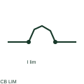

# ANSI/IEEE current-limiting circuit breaker symbol

IEEE-oriented graphical reference for current-limiting circuit breaker, with public vendor evidence and drawing-reading notes.

[Canonical reference](https://eloragrid.ai/symbols/ansi-current-limiting-circuit-breaker) · [Structured record](../entries/ansi-current-limiting-circuit-breaker.json) · [All references](README.md)

Updated: 2026-10-27. Drawing use: SLD, Schematic. Reference families: IEEE / ANSI, Manufacturer.

Graphical convention: IEEE / ANSI. Autodesk IEEE-oriented 1 Pole Circuit Breakers functional form.

## What it represents

A current-limiting breaker form identifies a fault-interruption characteristic associated with the selected breaker. It does not depict continuous regulation of the feeder current. The limiting designation needs the applicable manufacturer's let-through information.
This is a convention-specific lookup based on the publisher's IEEE-labelled preview. The geometry here is independently drawn to explain the connection or operation; it is not a certified reproduction of the standard graphic.

## How to read it

- Associate the limiting annotation with the breaker rather than the load.
- Read the selected library and the project legend together. A vendor block identifier is meaningful within its named library and is not a universal standard-symbol code.

## Drawing checklist

- Name limiting breaker
- Reference peak/energy data
- Identify prospective fault level

## Important distinction

Fault-current limitation is not the same circuit function as an adjustable current regulator.

## Facts

- Convention evidence: Autodesk IEEE Symbol Preview — 1 Pole Circuit Breakers
- Public vendor block name: HCB11THI (Autodesk identifier; not an IEEE symbol number)
- Standards context: IEEE/ANSI 315-1975 covers diagram graphics. IEEE lists this edition as Inactive-Reserved.
- Artwork scope: Original functional illustration; exact standard glyph and compliance are not certified

## Public references

- [Autodesk IEEE Symbol Preview — 1 Pole Circuit Breakers](https://help.autodesk.com/cloudhelp/2021/ENU/AutoCAD-Electrical/files/GUID-7F08A484-0517-4954-BD68-1648DDBC84A1.htm) — Autodesk. Exact public IEEE-oriented category page verifying the component name and vendor block identifier.
- [IEEE/ANSI 315-1975: graphic symbols for electrical and electronics diagrams](https://standards.ieee.org/ieee/315/515/) — IEEE Standards Association. Graphic-symbol standards context and official status; not a source of reproduced artwork.

## Related references

- [Current-limiting circuit breaker](current-limiting-circuit-breaker.md)
- [Circuit breaker](circuit-breaker.md)
- [AC circuit breaker](52-ac-circuit-breaker.md)

Original educational concept geometry, CC BY 4.0. Unitless; not a certified standards glyph or manufacturer footprint.

Elora-authored explanations are CC BY 4.0. Linked standards and manufacturer material retain their own rights. Confirm project requirements using primary sources.
