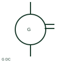

# ANSI/IEEE dc generator symbol

IEEE-oriented graphical reference for dc generator, with public vendor evidence and drawing-reading notes.

[Canonical reference](https://eloragrid.ai/symbols/ansi-dc-generator) · [Structured record](../entries/ansi-dc-generator.json) · [All references](README.md)

Updated: 2026-10-27. Drawing use: SLD, Schematic. Reference families: IEEE / ANSI, Manufacturer.

Graphical convention: IEEE / ANSI. Autodesk IEEE-oriented Generators functional form.

## What it represents

The DC generator form identifies a documented source of direct-current output. Polarity and excitation connections establish how the generated circuit supplies its load, while the mechanical prime mover is referenced separately.
This is a convention-specific lookup based on the publisher's IEEE-labelled preview. The geometry here is independently drawn to explain the connection or operation; it is not a certified reproduction of the standard graphic.

## How to read it

- Read source polarity before tracing downstream DC distribution.
- Read the selected library and the project legend together. A vendor block identifier is meaningful within its named library and is not a universal standard-symbol code.

## Drawing checklist

- State output rating
- Mark positive/negative terminals
- Reference excitation arrangement

## Important distinction

A DC source-generating function differs from a DC motor load despite related machine principles.

## Facts

- Convention evidence: Autodesk IEEE Symbol Preview — Generators
- Public vendor block name: HPW1G9 (Autodesk identifier; not an IEEE symbol number)
- Standards context: IEEE/ANSI 315-1975 covers diagram graphics. IEEE lists this edition as Inactive-Reserved.
- Artwork scope: Original functional illustration; exact standard glyph and compliance are not certified

## Public references

- [Autodesk IEEE Symbol Preview — Generators](https://help.autodesk.com/cloudhelp/2021/ENU/AutoCAD-Electrical/files/GUID-6A9FA93B-3010-4274-AE51-20DB3520999C.htm) — Autodesk. Exact public IEEE-oriented category page verifying the component name and vendor block identifier.
- [IEEE/ANSI 315-1975: graphic symbols for electrical and electronics diagrams](https://standards.ieee.org/ieee/315/515/) — IEEE Standards Association. Graphic-symbol standards context and official status; not a source of reproduced artwork.

## Related references

- [DC generator](dc-generator.md)
- [Generator](generator.md)
- [Synchronism check](25-synchronism-check.md)

Original educational concept geometry, CC BY 4.0. Unitless; not a certified standards glyph or manufacturer footprint.

Elora-authored explanations are CC BY 4.0. Linked standards and manufacturer material retain their own rights. Confirm project requirements using primary sources.
