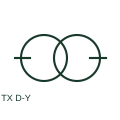

# ANSI/IEEE Delta-star transformer form

IEEE-library form of delta-star transformer: a delta-star transformer provides a delta-connected winding and a star-connected winding.

[Canonical reference](https://eloragrid.ai/symbols/ansi-delta-star-transformer) · [Structured record](../entries/ansi-delta-star-transformer.json) · [All references](README.md)

Updated: 2026-10-28. Drawing use: SLD, Schematic. Reference families: IEEE / ANSI, Manufacturer.

Graphical convention: IEEE / ANSI. 3 Phase Delta/Star.

## What it represents

This reference locates delta-star transformer in Autodesk's IEEE-oriented 3 phase transformers family. A delta-star transformer provides a delta-connected winding and a star-connected winding. Where the star point is brought out, its neutral and earthing arrangement are separate drawing requirements. The public library uses HXF1T14 for its horizontal representation; this is a vendor block name, not an IEEE standards symbol number.
Trace each winding, supply and accessible neutral through the complete machine or transformer connection diagram. Keep the phase arrangement, terminal labels and any clock notation attached to the device; neither the convention label nor this educational outline supplies its ratings.
Do not infer a grounded neutral merely from a star winding. A star winding can exist without an accessible or earthed neutral terminal. The linked functional counterpart explains the same operating role in its own drawing context; agreement of every detailed convention mark is not asserted.

## How to read it

- Do not infer a grounded neutral merely from a star winding.
- The preview is an original explanation of this function. Match the actual drawing convention to its legend and the selected equipment documentation.

## Drawing checklist

- State complete vector group
- Identify accessible neutral
- Reference neutral earthing

## Important distinction

A star winding can exist without an accessible or earthed neutral terminal.

## Facts

- Convention evidence: Autodesk IEEE Symbol Preview: 3 Phase Transformers; published form: 3 Phase Delta/Star.
- Public vendor block: HXF1T14. Vendor library token, not an IEEE symbol number.
- Drawing role: Winding connection
- Identifier status: The short label is a functional lookup label, not an assigned IEC or IEEE symbol number. Any separately listed Autodesk code is a verified vendor block name.
- Artwork scope: Original educational geometry. Exact standard graphics, product ratings and terminal pinouts are not certified.

## Public references

- [Autodesk IEEE Symbol Preview: 3 Phase Transformers](https://help.autodesk.com/cloudhelp/2021/ENU/AutoCAD-Electrical/files/GUID-EE75A5D4-8CBD-4E78-94A3-226A94E61817.htm) — Autodesk. Public IEEE-oriented 3 Phase Transformers table explicitly lists HXF1T14 as 3 Phase Delta/Star. This supports the vendor convention context, not reproduction of the publisher graphic.

## Related references

- [Delta-star transformer](delta-star-transformer.md)
- [Power transformer](power-transformer.md)
- [Voltage transformer](voltage-transformer.md)

Original educational concept geometry, CC BY 4.0. Unitless; not a certified standards glyph or manufacturer footprint.

Elora-authored explanations are CC BY 4.0. Linked standards and manufacturer material retain their own rights. Confirm project requirements using primary sources.
