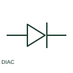

# ANSI/IEEE DIAC form

IEEE-library form of diac: a DIAC is a bidirectional triggering semiconductor device used in a documented control circuit.

[Canonical reference](https://eloragrid.ai/symbols/ansi-diac) · [Structured record](../entries/ansi-diac.json) · [All references](README.md)

Updated: 2026-10-28. Drawing use: Schematic. Reference families: IEEE / ANSI, Manufacturer.

Graphical convention: IEEE / ANSI. Diac Diode - Two Way.

## What it represents

This reference locates diac in Autodesk's IEEE-oriented semiconductor components family. A DIAC is a bidirectional triggering semiconductor device used in a documented control circuit. Its terminals and breakover characteristics are defined by the selected component. The public library uses HDI1V3 for its horizontal representation; this is a vendor block name, not an IEEE standards symbol number.
Follow the actual current path and terminal polarity in the surrounding circuit. The symbol identifies an electrical function; voltage, current, energy limits and the device package pinout come from the selected component data rather than from the outline.
Follow the trigger circuit rather than treating the device as a controlled switch with a separate gate. A DIAC does not have the same controlled gate terminal as a TRIAC. The linked functional counterpart explains the same operating role in its own drawing context; agreement of every detailed convention mark is not asserted.

## How to read it

- Follow the trigger circuit rather than treating the device as a controlled switch with a separate gate.
- The preview is an original explanation of this function. Match the actual drawing convention to its legend and the selected equipment documentation.

## Drawing checklist

- Identify connected terminals
- Reference breakover rating
- Show associated trigger network

## Important distinction

A DIAC does not have the same controlled gate terminal as a TRIAC.

## Facts

- Convention evidence: Autodesk IEEE Symbol Preview: Semiconductor Components; published form: Diac Diode - Two Way.
- Public vendor block: HDI1V3. Vendor library token, not an IEEE symbol number.
- Drawing role: Semiconductor function
- Identifier status: The short label is a functional lookup label, not an assigned IEC or IEEE symbol number. Any separately listed Autodesk code is a verified vendor block name.
- Artwork scope: Original educational geometry. Exact standard graphics, product ratings and terminal pinouts are not certified.

## Public references

- [Autodesk IEEE Symbol Preview — Semiconductor Components](https://help.autodesk.com/cloudhelp/2021/ENU/AutoCAD-Electrical/files/GUID-EC01CFC2-47B9-4AE3-AE5E-0FB86D327A82.htm) — Autodesk. Public IEEE-oriented Semiconductor Components table explicitly lists HDI1V3 as Diac Diode - Two Way. This supports the vendor convention context, not reproduction of the publisher graphic.

## Related references

- [DIAC](diac.md)
- [Resistor](resistor.md)
- [Power converter / inverter](power-converter.md)

Original educational concept geometry, CC BY 4.0. Unitless; not a certified standards glyph or manufacturer footprint.

Elora-authored explanations are CC BY 4.0. Linked standards and manufacturer material retain their own rights. Confirm project requirements using primary sources.
