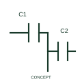

# ANSI/IEEE Differential capacitor form

IEEE-library form of differential capacitor: this representation distinguishes a differential capacitive arrangement with related variable capacitances.

[Canonical reference](https://eloragrid.ai/symbols/ansi-differential-capacitor) · [Structured record](../entries/ansi-differential-capacitor.json) · [All references](README.md)

Updated: 2026-10-28. Drawing use: Schematic. Reference families: IEEE / ANSI, Manufacturer.

Graphical convention: IEEE / ANSI. Capacitor,Differential.

## What it represents

This reference locates differential capacitor in Autodesk's IEEE-oriented capacitive components family. This representation distinguishes a differential capacitive arrangement with related variable capacitances. Related capacitor sections change in a coordinated differential arrangement. The common and section terminals therefore matter to interpreting the complete circuit. The public library uses HCA1\_S00573 for its horizontal representation; this is a vendor block name, not an IEEE standards symbol number.
Follow the actual current path and terminal polarity in the surrounding circuit. The symbol identifies an electrical function; voltage, current, energy limits and the device package pinout come from the selected component data rather than from the outline.
Show those electrodes and the adjustment relationship in the detailed schematic. A single capacitance value or a two-terminal capacitor representation can hide the additional circuit interface. Identify the electrode/common connections and the intended adjustment relationship. A differential capacitor is not a generic two-terminal fixed capacitor. The linked functional counterpart explains the same operating role in its own drawing context; agreement of every detailed convention mark is not asserted.

## How to read it

- Identify the electrode/common connections and the intended adjustment relationship.
- A differential capacitor is not a generic two-terminal fixed capacitor.

## Drawing checklist

- Identify the associated device, circuit or diagram boundary.
- Identify the electrode/common connections and the intended adjustment relationship.
- Cross-reference the equipment data, terminal mapping or operating-state legend needed to interpret the form.

## Important distinction

A differential capacitor is not a generic two-terminal fixed capacitor.

## Facts

- Convention evidence: Autodesk IEEE Symbol Preview: Capacitive Components; published form: Capacitor,Differential.
- Public vendor block: HCA1\_S00573. Vendor library token, not an IEEE symbol number.
- Information added: Identify the electrode/common connections and the intended adjustment relationship.
- Preview: Independent educational concept; consult the publisher and applicable standard for the exact graphic
- Artwork scope: Original educational geometry. Exact standard graphics, product ratings and terminal pinouts are not certified.

## Public references

- [Autodesk IEEE Symbol Preview — Capacitive Components](https://help.autodesk.com/cloudhelp/2021/ENU/AutoCAD-Electrical/files/GUID-0F8673C7-D786-441C-AB55-F2CDB8D5B288.htm) — Autodesk. Public IEEE-oriented Capacitive Components table explicitly lists HCA1\_S00573 as Capacitor,Differential. This supports the vendor convention context, not reproduction of the publisher graphic.

## Related references

- [Differential capacitor](iec-differential-capacitor.md)
- [Resistor](resistor.md)
- [Capacitor](capacitor.md)

Original educational concept geometry, CC BY 4.0. Unitless; not a certified standards glyph or manufacturer footprint.

Elora-authored explanations are CC BY 4.0. Linked standards and manufacturer material retain their own rights. Confirm project requirements using primary sources.
