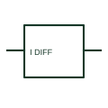

# ANSI/IEEE Differential-current measuring relay form

IEEE-library form of differential-current measuring relay: a differential-current relay responds to the relationship between specified current inputs.

[Canonical reference](https://eloragrid.ai/symbols/ansi-differential-current-measuring-relay) · [Structured record](../entries/ansi-differential-current-measuring-relay.json) · [All references](README.md)

Updated: 2026-10-28. Drawing use: SLD, Schematic. Reference families: IEEE / ANSI, Manufacturer.

Graphical convention: IEEE / ANSI. Differential Current Protection.

## What it represents

This reference locates differential-current measuring relay in Autodesk's IEEE-oriented current protection relays family. A differential-current relay responds to the relationship between specified current inputs. The schematic must identify input directions, ratio matching and the protected or monitored zone. The public library uses HCR1F29 for its horizontal representation; this is a vendor block name, not an IEEE standards symbol number.
Trace the measured quantity or initiating control signal separately from the output contacts. The device tag links the sensing or operating element to the controlled circuit; settings, reset behaviour and the actual terminal arrangement belong in the selected equipment documentation.
Follow polarity and reference directions on all compared current circuits. Differential measurement is not simply a single high-current threshold. The linked functional counterpart explains the same operating role in its own drawing context; agreement of every detailed convention mark is not asserted.

## How to read it

- Follow polarity and reference directions on all compared current circuits.
- The preview is an original explanation of this function. Match the actual drawing convention to its legend and the selected equipment documentation.

## Drawing checklist

- Identify compared inputs
- Show polarity references
- Link setting and zone documentation

## Important distinction

Differential measurement is not simply a single high-current threshold.

## Facts

- Convention evidence: Autodesk IEEE Symbol Preview: Current Protection Relays; published form: Differential Current Protection.
- Public vendor block: HCR1F29. Vendor library token, not an IEEE symbol number.
- Drawing role: Monitoring element
- Identifier status: The short label is a functional lookup label, not an assigned IEC or IEEE symbol number. Any separately listed Autodesk code is a verified vendor block name.
- Artwork scope: Original educational geometry. Exact standard graphics, product ratings and terminal pinouts are not certified.

## Public references

- [Autodesk IEEE Symbol Preview: Current Protection Relays](https://help.autodesk.com/cloudhelp/2021/ENU/AutoCAD-Electrical/files/GUID-EC11EC4D-374C-4191-9534-C802D3932711.htm) — Autodesk. Public IEEE-oriented Current Protection Relays table explicitly lists HCR1F29 as Differential Current Protection. This supports the vendor convention context, not reproduction of the publisher graphic.

## Related references

- [Differential-current measuring relay](differential-current-measuring-relay.md)
- [Current transformer](current-transformer.md)
- [Relay coil](relay-coil.md)

Original educational concept geometry, CC BY 4.0. Unitless; not a certified standards glyph or manufacturer footprint.

Elora-authored explanations are CC BY 4.0. Linked standards and manufacturer material retain their own rights. Confirm project requirements using primary sources.
