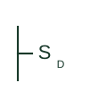

# ANSI dimmer switch plan symbol

US plan symbol SD for a wall dimmer controlling a lighting group.

[Canonical reference](https://eloragrid.ai/symbols/ansi-dimmer-switch) · [Structured record](../entries/ansi-dimmer-switch.json) · [All references](README.md)

Updated: 2026-10-28. Drawing use: GA. Reference families: IEEE / ANSI.

Graphical convention: IEEE / ANSI. Dimmer switch, SD.

## What it represents

A wall dimmer in US plan practice is drawn as S with subscript D, sometimes with a wattage note. The switch leg links it to the dimmed group, and three-way dimming is shown by pairing SD with S3 or with a companion device.
The reader should check dimmer type against LED driver compatibility, and whether the dimmer controls a low-voltage 0-10 V signal or switches line power directly. The plan symbol is identical for both. SD does not specify dimming technology, load or whether multi-gang derating applies.

## How to read it

- Check dimming technology in the fixture schedule.
- Note multi-gang derating for ganged dimmers.

## Drawing checklist

- State dimmer load rating.
- State control method.
- Link the dimmed group.

## Important distinction

The IEC dimmer uses a variability arrow on a switch mark; the US form uses the D subscript.

## Facts

- Graphic form: S with subscript D
- Key check: Driver compatibility
- Artwork scope: Original educational illustration; the exact ANSI or IEEE graphic and compliance are not certified

## Public references

- [IEEE/ANSI 315-1975: graphic symbols for electrical and electronics diagrams](https://standards.ieee.org/ieee/315/515/) — IEEE Standards Association. Graphic-symbol standards context; not a source of reproduced artwork.

## Related references

- [Dimmer switch plan mark](iec-dimmer-switch.md)
- [ANSI single-pole switch plan symbol](ansi-single-pole-switch.md)

Original educational concept geometry, CC BY 4.0. Unitless; not a certified standards glyph or manufacturer footprint.

Elora-authored explanations are CC BY 4.0. Linked standards and manufacturer material retain their own rights. Confirm project requirements using primary sources.
