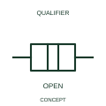

# ANSI/IEEE Disconnected mechanical coupling form

IEEE-library form of disconnected mechanical coupling: this indication identifies the disconnected state of a mechanical coupling.

[Canonical reference](https://eloragrid.ai/symbols/ansi-disconnected-mechanical-coupling) · [Structured record](../entries/ansi-disconnected-mechanical-coupling.json) · [All references](README.md)

Updated: 2026-10-28. Drawing use: Schematic. Reference families: IEEE / ANSI, Manufacturer.

Graphical convention: IEEE / ANSI. Disconnected Joint.

## What it represents

This reference locates disconnected mechanical coupling in Autodesk's IEEE-oriented mechanical controls, coupling family. This indication identifies the disconnected state of a mechanical coupling. The driving and driven elements are represented without an engaged torque or motion-transmission relationship in this state. Either element can still have electrical connections. The public library uses Q021217 for its horizontal representation; this is a vendor block name, not an IEEE standards symbol number.
Read the operating mechanism and the contact reference state together. Cross-reference every associated contact to the same device and show which movement, signal or reset changes its condition; the symbol alone does not establish the complete switching sequence.
Use the state diagram or mechanism schedule to define what causes engagement. The disconnected coupling mark should not be substituted for a power isolation symbol. Read the state within the documented mechanism sequence. A disconnected coupling state is separate from the isolation of an electrical supply. The linked functional counterpart explains the same operating role in its own drawing context; agreement of every detailed convention mark is not asserted.

## How to read it

- Read the state within the documented mechanism sequence.
- A disconnected coupling state is separate from the isolation of an electrical supply.

## Drawing checklist

- Identify the associated device, circuit or diagram boundary.
- Read the state within the documented mechanism sequence.
- Cross-reference the equipment data, terminal mapping or operating-state legend needed to interpret the form.

## Important distinction

A disconnected coupling state is separate from the isolation of an electrical supply.

## Facts

- Convention evidence: Autodesk IEEE Symbol Preview: Mechanical Controls, Coupling; published form: Disconnected Joint.
- Public vendor block: Q021217. Vendor library token, not an IEEE symbol number.
- Information added: Read the state within the documented mechanism sequence.
- Preview: Independent educational concept; consult the publisher and applicable standard for the exact graphic
- Artwork scope: Original educational geometry. Exact standard graphics, product ratings and terminal pinouts are not certified.

## Public references

- [Autodesk IEEE Symbol Preview: Mechanical Controls, Coupling](https://help.autodesk.com/cloudhelp/2021/ENU/AutoCAD-Electrical/files/GUID-3B784797-C632-4E0A-BCDC-D7E4D982FE34.htm) — Autodesk. Public IEEE-oriented Mechanical Controls, Coupling table explicitly lists Q021217 as Disconnected Joint. This supports the vendor convention context, not reproduction of the publisher graphic.

## Related references

- [Disconnected mechanical coupling](iec-disconnected-mechanical-coupling.md)
- [Relay coil](relay-coil.md)
- [Normally open contact](normally-open-contact.md)

Original educational concept geometry, CC BY 4.0. Unitless; not a certified standards glyph or manufacturer footprint.

Elora-authored explanations are CC BY 4.0. Linked standards and manufacturer material retain their own rights. Confirm project requirements using primary sources.
