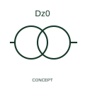

# ANSI/IEEE Dz0 transformer connection reference form

IEEE-library form of dz0 transformer connection reference: this reference identifies the publisher's Dz0 transformer connection form with delta/zigzag winding topology.

[Canonical reference](https://eloragrid.ai/symbols/ansi-dz0-transformer-connection-reference) · [Structured record](../entries/ansi-dz0-transformer-connection-reference.json) · [All references](README.md)

Updated: 2026-10-28. Drawing use: SLD, Schematic. Reference families: IEEE / ANSI, Manufacturer.

Graphical convention: IEEE / ANSI. 3 Phase Dz0.

## What it represents

This reference locates dz0 transformer connection reference in Autodesk's IEEE-oriented 3 phase transformers family. Dz0 combines an HV-side delta winding designation with an LV-side zigzag designation and clock group 0. The letters describe connection topology; the final number identifies the phase relationship recorded with the transformer connection diagram. It is different from the voltage ratio or the number of terminals. The public library uses HXF1T27 for its horizontal representation; this is a vendor block name, not an IEEE standards symbol number.
Trace each winding, supply and accessible neutral through the complete machine or transformer connection diagram. Keep the phase arrangement, terminal labels and any clock notation attached to the device; neither the convention label nor this educational outline supplies its ratings.
A drafter should preserve the full Dz0 designation across the SLD, transformer schedule and protection references. A zigzag winding must retain its own topology label rather than be abbreviated to an ordinary star winding. Check the selected transformer terminal diagram and the protection application documentation; the concept preview does not specify polarity tests, parallel-operation suitability or relay settings. Preserve the full group notation and verify the terminal/phase relationship in the selected transformer diagram. The clock-group suffix is different from a voltage ratio, power rating or physical terminal number. The linked functional counterpart explains the same operating role in its own drawing context; agreement of every detailed convention mark is not asserted.

## How to read it

- Preserve the full group notation and verify the terminal/phase relationship in the selected transformer diagram.
- The clock-group suffix is different from a voltage ratio, power rating or physical terminal number.

## Drawing checklist

- Identify the associated device, circuit or diagram boundary.
- Preserve the full group notation and verify the terminal/phase relationship in the selected transformer diagram.
- Cross-reference the equipment data, terminal mapping or operating-state legend needed to interpret the form.

## Important distinction

The clock-group suffix is different from a voltage ratio, power rating or physical terminal number.

## Facts

- Convention evidence: Autodesk IEEE Symbol Preview: 3 Phase Transformers; published form: 3 Phase Dz0.
- Public vendor block: HXF1T27. Vendor library token, not an IEEE symbol number.
- Information added: Preserve the full group notation and verify the terminal/phase relationship in the selected transformer diagram.
- Preview: Independent educational concept; consult the publisher and applicable standard for the exact graphic
- HV winding topology: delta
- Artwork scope: Original educational geometry. Exact standard graphics, product ratings and terminal pinouts are not certified.

## Public references

- [Autodesk IEEE Symbol Preview: 3 Phase Transformers](https://help.autodesk.com/cloudhelp/2021/ENU/AutoCAD-Electrical/files/GUID-EE75A5D4-8CBD-4E78-94A3-226A94E61817.htm) — Autodesk. Public IEEE-oriented 3 Phase Transformers table explicitly lists HXF1T27 as 3 Phase Dz0. This supports the vendor convention context, not reproduction of the publisher graphic.

## Related references

- [Dz0 transformer connection reference](iec-dz0-transformer-connection-reference.md)
- [Power transformer](power-transformer.md)
- [Voltage transformer](voltage-transformer.md)

Original educational concept geometry, CC BY 4.0. Unitless; not a certified standards glyph or manufacturer footprint.

Elora-authored explanations are CC BY 4.0. Linked standards and manufacturer material retain their own rights. Confirm project requirements using primary sources.
