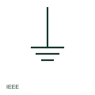

# ANSI/IEEE earth connection symbol

IEEE-oriented ground symbol with three diminishing bars, used for a general connection to earth.

[Canonical reference](https://eloragrid.ai/symbols/ansi-earth-connection) · [Structured record](../entries/ansi-earth-connection.json) · [All references](README.md)

Updated: 2026-10-28. Drawing use: SLD, Schematic. Reference families: IEEE / ANSI, Manufacturer.

Graphical convention: IEEE / ANSI. Autodesk IEEE-oriented Earth/Ground form.

## What it represents

US-practice drawings show a connection to earth ground with a vertical lead ending in three horizontal bars of decreasing length. The publisher's IEEE miscellaneous preview lists an Earth/Ground form alongside functional and protective forms, which the existing ANSI pages for those concepts already cover.
This is an independently drawn explanation rather than the IEEE graphic. The general ground symbol does not say whether the connection is for safety or function; where the distinction matters, use the protective or functional form. Grounding electrode details belong on the grounding plan.

## How to read it

- Check whether a protective or functional form should be used instead.
- Find the grounding electrode system on the grounding plan.

## Drawing checklist

- Use the general symbol only where the purpose is clear.
- Reference the grounding plan.
- Keep symbol usage consistent across the set.

## Important distinction

The general ground symbol marks any earth connection; the ANSI protective earth form specifically marks a safety ground.

## Facts

- Convention evidence: Autodesk IEEE Symbol Preview: Miscellaneous (Earth/Ground)
- Public vendor block name: HGND2 (Autodesk identifier; not an IEEE symbol number)
- Standards context: IEEE/ANSI 315-1975 covers diagram graphics; IEEE lists this edition as Inactive-Reserved.
- Preview: Original educational illustration; consult the publisher and applicable standard for the exact graphic

## Public references

- [Autodesk IEEE Symbol Preview — Miscellaneous](https://help.autodesk.com/cloudhelp/2021/ENU/AutoCAD-Electrical/files/GUID-34282BFD-7B8E-48F3-A6ED-93ADBDDDFBD3.htm) — Autodesk. Exact public IEEE-oriented category page listing the Earth/Ground form.
- [IEEE/ANSI 315-1975: graphic symbols for electrical and electronics diagrams](https://standards.ieee.org/ieee/315/515/) — IEEE Standards Association. Graphic-symbol standards context and official status; not a source of reproduced artwork.

## Related references

- [Earth connection](earth-connection.md)
- [ANSI/IEEE protective earth symbol](ansi-protective-earth.md)
- [ANSI/IEEE functional earth symbol](ansi-functional-earth.md)

Original educational concept geometry, CC BY 4.0. Unitless; not a certified standards glyph or manufacturer footprint.

Elora-authored explanations are CC BY 4.0. Linked standards and manufacturer material retain their own rights. Confirm project requirements using primary sources.
