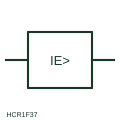

# ANSI/IEEE Earth-fault current relay form

IEEE-library form of earth-fault current relay: measuring relay form that operates on current flowing to earth, fed from a residual connection or core-balance CT.

[Canonical reference](https://eloragrid.ai/symbols/ansi-earth-fault-current-relay) · [Structured record](../entries/ansi-earth-fault-current-relay.json) · [All references](README.md)

Updated: 2026-10-28. Drawing use: Schematic, SLD. Reference families: IEEE / ANSI, Manufacturer.

Graphical convention: IEEE / ANSI. Ground Failure Current Protection.

## What it represents

This reference locates earth-fault current relay in Autodesk's IEEE-oriented current protection relays family. The earth-fault current relay form identifies a relay whose operating quantity is current flowing to earth. It may be fed from a core-balance CT around all live conductors, from the residual connection of three phase CTs, or from a CT in the star-point earth lead, and the source changes its achievable sensitivity. The public library uses HCR1F37 for its horizontal representation; this is a vendor block name, not an IEEE standards symbol number.
Trace the measured quantity or initiating control signal separately from the output contacts. The device tag links the sensing or operating element to the controlled circuit; settings, reset behaviour and the actual terminal arrangement belong in the selected equipment documentation.
The relay box shows the quantity with an earth qualifier but not the setting, characteristic or whether it is directional. In resistance-earthed and isolated networks earth-fault current is small and often needs a sensitive or directional element that must be stated separately. Identify the CT arrangement that supplies the residual current. An earth-fault current relay measures current to earth; an earth-fault voltage relay measures neutral displacement voltage. The linked functional counterpart explains the same operating role in its own drawing context; agreement of every detailed convention mark is not asserted.

## How to read it

- Identify the CT arrangement that supplies the residual current.
- Check whether the element is directional or sensitive.

## Drawing checklist

- Show residual CT source
- State setting and characteristic
- Reference system earthing method

## Important distinction

An earth-fault current relay measures current to earth; an earth-fault voltage relay measures neutral displacement voltage.

## Facts

- Convention evidence: Autodesk IEEE Symbol Preview: Current Protection Relays; published form: Ground Failure Current Protection.
- Public vendor block: HCR1F37. Vendor library token, not an IEEE symbol number.
- Measured quantity: Residual or earth-fault current
- Preview: Independent educational concept; consult the publisher and applicable standard for the exact graphic
- Artwork scope: Original educational geometry. Exact standard graphics, product ratings and terminal pinouts are not certified.

## Public references

- [Autodesk IEEE Symbol Preview: Current Protection Relays](https://help.autodesk.com/cloudhelp/2021/ENU/AutoCAD-Electrical/files/GUID-EC11EC4D-374C-4191-9534-C802D3932711.htm) — Autodesk. Public IEEE-oriented Current Protection Relays table explicitly lists HCR1F37 as Ground Failure Current Protection. This supports the vendor convention context, not reproduction of the publisher graphic.

## Related references

- [Earth-fault current relay](earth-fault-current-relay.md)
- [Core-balance current transformer](core-balance-current-transformer.md)
- [Residual connection of phase CTs](residual-connection-of-phase-cts.md)
- [Time overcurrent](51-time-overcurrent.md)

Original educational concept geometry, CC BY 4.0. Unitless; not a certified standards glyph or manufacturer footprint.

Elora-authored explanations are CC BY 4.0. Linked standards and manufacturer material retain their own rights. Confirm project requirements using primary sources.
