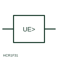

# ANSI/IEEE Earth-fault voltage relay form

IEEE-library form of earth-fault voltage relay: relay form that operates on a voltage appearing because of an earth fault, such as between a frame and earth.

[Canonical reference](https://eloragrid.ai/symbols/ansi-earth-fault-voltage-relay) · [Structured record](../entries/ansi-earth-fault-voltage-relay.json) · [All references](README.md)

Updated: 2026-10-28. Drawing use: Schematic, SLD. Reference families: IEEE / ANSI, Manufacturer.

Graphical convention: IEEE / ANSI. Ground Failure Voltage Protection.

## What it represents

This reference locates earth-fault voltage relay in Autodesk's IEEE-oriented voltage protection relays family. This relay measures a voltage that appears only when there is an earth fault, for example between exposed metalwork and a reference earth, or across a neutral earthing impedance. It is useful where earth-fault current is limited and a voltage is easier to detect than a current. The public library uses HCR1F31 for its horizontal representation; this is a vendor block name, not an IEEE standards symbol number.
Trace the measured quantity or initiating control signal separately from the output contacts. The device tag links the sensing or operating element to the controlled circuit; settings, reset behaviour and the actual terminal arrangement belong in the selected equipment documentation.
The symbol does not say where the voltage is measured. A relay across a neutral earthing resistor and one connected between frame and auxiliary earth electrode have very different settings, so the measurement points must be drawn and labelled. Trace both measurement connections of the relay. An earth-fault voltage relay measures fault-related voltage; a residual voltage relay measures zero-sequence voltage from VT windings. The linked functional counterpart explains the same operating role in its own drawing context; agreement of every detailed convention mark is not asserted.

## How to read it

- Trace both measurement connections of the relay.
- Check the reference earth used by the relay.

## Drawing checklist

- Show measurement points
- State threshold and delay
- Reference earthing arrangement

## Important distinction

An earth-fault voltage relay measures fault-related voltage; a residual voltage relay measures zero-sequence voltage from VT windings.

## Facts

- Convention evidence: Autodesk IEEE Symbol Preview: Voltage Protection Relays; published form: Ground Failure Voltage Protection.
- Public vendor block: HCR1F31. Vendor library token, not an IEEE symbol number.
- Measured quantity: Voltage caused by an earth fault
- Preview: Independent educational concept; consult the publisher and applicable standard for the exact graphic
- Artwork scope: Original educational geometry. Exact standard graphics, product ratings and terminal pinouts are not certified.

## Public references

- [Autodesk IEEE Symbol Preview: Voltage Protection Relays](https://help.autodesk.com/cloudhelp/2021/ENU/AutoCAD-Electrical/files/GUID-5D942536-ADE3-43EA-8280-CC7907C38F15.htm) — Autodesk. Public IEEE-oriented Voltage Protection Relays table explicitly lists HCR1F31 as Ground Failure Voltage Protection. This supports the vendor convention context, not reproduction of the publisher graphic.

## Related references

- [Earth-fault voltage relay](earth-fault-voltage-relay.md)
- [Residual-voltage monitoring relay](residual-voltage-monitoring-relay.md)
- [Earth-fault current relay](earth-fault-current-relay.md)
- [Ground detector protection](64-ground-detector-protection.md)

Original educational concept geometry, CC BY 4.0. Unitless; not a certified standards glyph or manufacturer footprint.

Elora-authored explanations are CC BY 4.0. Linked standards and manufacturer material retain their own rights. Confirm project requirements using primary sources.
