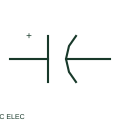

# ANSI/IEEE electrolytic capacitor symbol

IEEE-oriented graphical reference for electrolytic capacitor, with public vendor evidence and drawing-reading notes.

[Canonical reference](https://eloragrid.ai/symbols/ansi-electrolytic-capacitor) · [Structured record](../entries/ansi-electrolytic-capacitor.json) · [All references](README.md)

Updated: 2026-10-27. Drawing use: SLD, Schematic. Reference families: IEEE / ANSI, Manufacturer.

Graphical convention: IEEE / ANSI. Autodesk IEEE-oriented Capacitive Components functional form.

## What it represents

The electrolytic capacitor form adds a documented construction or polarity qualifier to the capacitive function. The actual component determines whether polarity marking is required; this original preview illustrates a polarised use rather than declaring every electrolytic type identical.
This is a convention-specific lookup based on the publisher's IEEE-labelled preview. The geometry here is independently drawn to explain the connection or operation; it is not a certified reproduction of the standard graphic.

## How to read it

- Check component polarity and allowed voltage before following the DC connection.
- Read the selected library and the project legend together. A vendor block identifier is meaningful within its named library and is not a universal standard-symbol code.

## Drawing checklist

- State capacitance/voltage
- Preserve documented polarity
- Reference component type

## Important distinction

Electrolytic construction is different from simply rotating a generic capacitor graphic.

## Facts

- Convention evidence: Autodesk IEEE Symbol Preview — Capacitive Components
- Public vendor block name: HCA1EL (Autodesk identifier; not an IEEE symbol number)
- Standards context: IEEE/ANSI 315-1975 covers diagram graphics. IEEE lists this edition as Inactive-Reserved.
- Artwork scope: Original functional illustration; exact standard glyph and compliance are not certified

## Public references

- [Autodesk IEEE Symbol Preview — Capacitive Components](https://help.autodesk.com/cloudhelp/2021/ENU/AutoCAD-Electrical/files/GUID-0F8673C7-D786-441C-AB55-F2CDB8D5B288.htm) — Autodesk. Exact public IEEE-oriented category page verifying the component name and vendor block identifier.
- [IEEE/ANSI 315-1975: graphic symbols for electrical and electronics diagrams](https://standards.ieee.org/ieee/315/515/) — IEEE Standards Association. Graphic-symbol standards context and official status; not a source of reproduced artwork.

## Related references

- [Electrolytic capacitor](electrolytic-capacitor.md)
- [Resistor](resistor.md)
- [Capacitor](capacitor.md)

Original educational concept geometry, CC BY 4.0. Unitless; not a certified standards glyph or manufacturer footprint.

Elora-authored explanations are CC BY 4.0. Linked standards and manufacturer material retain their own rights. Confirm project requirements using primary sources.
