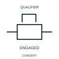

# ANSI/IEEE Engaged mechanical coupling form

IEEE-library form of engaged mechanical coupling: this indication identifies engagement between the represented mechanical elements.

[Canonical reference](https://eloragrid.ai/symbols/ansi-engaged-mechanical-coupling) · [Structured record](../entries/ansi-engaged-mechanical-coupling.json) · [All references](README.md)

Updated: 2026-10-28. Drawing use: Schematic. Reference families: IEEE / ANSI, Manufacturer.

Graphical convention: IEEE / ANSI. Engaged Joint.

## What it represents

This reference locates engaged mechanical coupling in Autodesk's IEEE-oriented mechanical controls, coupling family. This indication identifies engagement between the represented mechanical elements. The represented elements share the documented motion-transmission relationship in the engaged state. That state says nothing by itself about supply energisation or electrical contact position. The public library uses Q021218 for its horizontal representation; this is a vendor block name, not an IEEE standards symbol number.
Read the operating mechanism and the contact reference state together. Cross-reference every associated contact to the same device and show which movement, signal or reset changes its condition; the symbol alone does not establish the complete switching sequence.
Show the driving/driven device identities and connect the engagement state to its actual feedback if used. Alternate publisher graphical forms are retained within this one concept. Document the elements coupled and the applicable state condition. Different published graphical forms for the same engagement are kept in one concept record. The linked functional counterpart explains the same operating role in its own drawing context; agreement of every detailed convention mark is not asserted.

## How to read it

- Document the elements coupled and the applicable state condition.
- Different published graphical forms for the same engagement are kept in one concept record.

## Drawing checklist

- Identify the associated device, circuit or diagram boundary.
- Document the elements coupled and the applicable state condition.
- Cross-reference the equipment data, terminal mapping or operating-state legend needed to interpret the form.

## Important distinction

Different published graphical forms for the same engagement are kept in one concept record.

## Facts

- Convention evidence: Autodesk IEEE Symbol Preview: Mechanical Controls, Coupling; published form: Engaged Joint.
- Public vendor block: Q021218. Vendor library token, not an IEEE symbol number.
- Information added: Document the elements coupled and the applicable state condition.
- Preview: Independent educational concept; consult the publisher and applicable standard for the exact graphic
- Artwork scope: Original educational geometry. Exact standard graphics, product ratings and terminal pinouts are not certified.

## Public references

- [Autodesk IEEE Symbol Preview: Mechanical Controls, Coupling](https://help.autodesk.com/cloudhelp/2021/ENU/AutoCAD-Electrical/files/GUID-3B784797-C632-4E0A-BCDC-D7E4D982FE34.htm) — Autodesk. Public IEEE-oriented Mechanical Controls, Coupling table explicitly lists Q021218 as Engaged Joint. This supports the vendor convention context, not reproduction of the publisher graphic.

## Related references

- [Engaged mechanical coupling](iec-engaged-mechanical-coupling.md)
- [Relay coil](relay-coil.md)
- [Normally open contact](normally-open-contact.md)

Original educational concept geometry, CC BY 4.0. Unitless; not a certified standards glyph or manufacturer footprint.

Elora-authored explanations are CC BY 4.0. Linked standards and manufacturer material retain their own rights. Confirm project requirements using primary sources.
