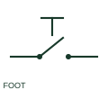

# ANSI/IEEE Foot-operated switch form

IEEE-library form of foot-operated switch: a foot-operated switch uses a pedal mechanism to change an electrical contact.

[Canonical reference](https://eloragrid.ai/symbols/ansi-foot-operated-switch) · [Structured record](../entries/ansi-foot-operated-switch.json) · [All references](README.md)

Updated: 2026-10-28. Drawing use: Schematic. Reference families: IEEE / ANSI, Manufacturer.

Graphical convention: IEEE / ANSI. Pedal Switch, Normally Open.

## What it represents

This reference locates foot-operated switch in Autodesk's IEEE-oriented miscellaneous switches family. A foot-operated switch uses a pedal mechanism to change an electrical contact. Its schematic should state the contact state and whether the operator is momentary or retained. The public library uses HFT11 for its horizontal representation; this is a vendor block name, not an IEEE standards symbol number.
Read the operating mechanism and the contact reference state together. Cross-reference every associated contact to the same device and show which movement, signal or reset changes its condition; the symbol alone does not establish the complete switching sequence.
Identify the pedal's return action and any guard shown by the equipment specification. Foot actuation describes the operator, not the safety category of the circuit. The linked functional counterpart explains the same operating role in its own drawing context; agreement of every detailed convention mark is not asserted.

## How to read it

- Identify the pedal's return action and any guard shown by the equipment specification.
- The preview is an original explanation of this function. Match the actual drawing convention to its legend and the selected equipment documentation.

## Drawing checklist

- State contact type
- Reference return mechanism
- Identify connected control function

## Important distinction

Foot actuation describes the operator, not the safety category of the circuit.

## Facts

- Convention evidence: Autodesk IEEE Symbol Preview: Miscellaneous Switches; published form: Pedal Switch, Normally Open.
- Public vendor block: HFT11. Vendor library token, not an IEEE symbol number.
- Drawing role: Manual operation
- Identifier status: The short label is a functional lookup label, not an assigned IEC or IEEE symbol number. Any separately listed Autodesk code is a verified vendor block name.
- Artwork scope: Original educational geometry. Exact standard graphics, product ratings and terminal pinouts are not certified.

## Public references

- [Autodesk IEEE Symbol Preview — Miscellaneous Switches](https://help.autodesk.com/cloudhelp/2021/ENU/AutoCAD-Electrical/files/GUID-278F6C21-B1A6-4EA1-A535-E78D53BBD10D.htm) — Autodesk. Public IEEE-oriented Miscellaneous Switches table explicitly lists HFT11 as Pedal Switch, Normally Open. This supports the vendor convention context, not reproduction of the publisher graphic.

## Related references

- [Foot-operated switch](foot-operated-switch.md)
- [Normally open pushbutton](pushbutton-no.md)
- [Normally closed pushbutton](pushbutton-nc.md)

Original educational concept geometry, CC BY 4.0. Unitless; not a certified standards glyph or manufacturer footprint.

Elora-authored explanations are CC BY 4.0. Linked standards and manufacturer material retain their own rights. Confirm project requirements using primary sources.
