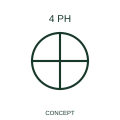

# ANSI/IEEE Four-phase winding with accessible connection form

IEEE-library reference for four-phase winding with accessible connection, with its operating meaning, connection notes and public vendor block identity.

[Canonical reference](https://eloragrid.ai/symbols/ansi-four-phase-winding-with-accessible-connection) · [Structured record](../entries/ansi-four-phase-winding-with-accessible-connection.json) · [All references](README.md)

Updated: 2026-10-28. Drawing use: SLD, Schematic. Reference families: IEEE / ANSI, Manufacturer.

Graphical convention: IEEE / ANSI. 4 Phase Winding with Accessible Ground.

## What it represents

This reference locates four-phase winding with accessible connection in Autodesk's IEEE-oriented winding family. This qualifier identifies a four-phase winding form with an accessible connection described by the publisher as accessible ground. The public library uses Q060203 for its horizontal representation; this is a vendor block name, not an IEEE standards symbol number.
Trace each winding, supply and accessible neutral through the complete machine or transformer connection diagram. Keep the phase arrangement, terminal labels and any clock notation attached to the device; neither the convention label nor this educational outline supplies its ratings.
Identify that connection in the actual winding and equipment diagram rather than assuming its bonding role. An accessible common point is not automatically a protective-earth terminal. Identify that connection in the actual winding and equipment diagram rather than assuming its bonding role. An accessible common point is not automatically a protective-earth terminal. The linked functional counterpart explains the same operating role in its own drawing context; agreement of every detailed convention mark is not asserted.

## How to read it

- Identify that connection in the actual winding and equipment diagram rather than assuming its bonding role.
- An accessible common point is not automatically a protective-earth terminal.

## Drawing checklist

- Identify the associated device, circuit or diagram boundary.
- Identify that connection in the actual winding and equipment diagram rather than assuming its bonding role.
- Cross-reference the equipment data, terminal mapping or operating-state legend needed to interpret the form.

## Important distinction

An accessible common point is not automatically a protective-earth terminal.

## Facts

- Convention evidence: Autodesk IEEE Symbol Preview: Winding; published form: 4 Phase Winding with Accessible Ground.
- Public vendor block: Q060203. Vendor library token, not an IEEE symbol number.
- Information added: Identify that connection in the actual winding and equipment diagram rather than assuming its bonding role.
- Preview: Independent educational concept; consult the publisher and applicable standard for the exact graphic
- Artwork scope: Original educational geometry. Exact standard graphics, product ratings and terminal pinouts are not certified.

## Public references

- [Autodesk IEEE Symbol Preview: Winding](https://help.autodesk.com/cloudhelp/2021/ENU/AutoCAD-Electrical/files/GUID-19F0C368-8E22-46C6-BFC1-D311EED77CA5.htm) — Autodesk. Public IEEE-oriented Winding table explicitly lists Q060203 as 4 Phase Winding with Accessible Ground. This supports the vendor convention context, not reproduction of the publisher graphic.

## Related references

- [Four-phase winding with accessible connection](iec-four-phase-winding-with-accessible-connection.md)
- [Three-phase motor](motor.md)
- [Generator](generator.md)

Original educational concept geometry, CC BY 4.0. Unitless; not a certified standards glyph or manufacturer footprint.

Elora-authored explanations are CC BY 4.0. Linked standards and manufacturer material retain their own rights. Confirm project requirements using primary sources.
