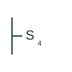

# ANSI four-way switch plan symbol

US plan symbol S4 for a four-way switch placed between two three-way switches to add control points.

[Canonical reference](https://eloragrid.ai/symbols/ansi-four-way-switch) · [Structured record](../entries/ansi-four-way-switch.json) · [All references](README.md)

Updated: 2026-10-28. Drawing use: GA. Reference families: IEEE / ANSI.

Graphical convention: IEEE / ANSI. Four-way switch, S4.

## What it represents

The S4 symbol marks a four-way switch, which crosses the travellers between two three-way switches. Any number of S4 switches can be added along the travellers, so long corridors and rooms with several entries show S3 at the ends and S4 between.
Reading the plan, the installer checks that S4 never appears without a pair of S3 switches on the same group. The IEC equivalent is the intermediate switch.
The symbol gives no information about the device rating or style. Smart switching systems may replace this wiring scheme with a master and companion device, which should be noted.

## How to read it

- Confirm two S3 switches exist on the same group.
- Watch for smart-switch notes that change the wiring scheme.

## Drawing checklist

- Show S3 at each end.
- Number control points for clarity.
- State any smart-control alternative.

## Important distinction

S3 changes over; S4 crosses two travellers and only works between S3 switches.

## Facts

- Contact: Crossover of two travellers
- IEC equivalent term: Intermediate switch
- Artwork scope: Original educational illustration; the exact ANSI or IEEE graphic and compliance are not certified

## Public references

- [IEEE/ANSI 315-1975: graphic symbols for electrical and electronics diagrams](https://standards.ieee.org/ieee/315/515/) — IEEE Standards Association. Graphic-symbol standards context; not a source of reproduced artwork.

## Related references

- [Intermediate light switch plan mark](iec-intermediate-light-switch.md)
- [ANSI three-way switch plan symbol](ansi-three-way-switch.md)

Original educational concept geometry, CC BY 4.0. Unitless; not a certified standards glyph or manufacturer footprint.

Elora-authored explanations are CC BY 4.0. Linked standards and manufacturer material retain their own rights. Confirm project requirements using primary sources.
