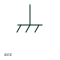

# ANSI/IEEE functional equipotential bonding symbol

IEEE-oriented functional equipotential bond used to keep equipment at a common reference for operation or noise control.

[Canonical reference](https://eloragrid.ai/symbols/ansi-functional-equipotential-bonding) · [Structured record](../entries/ansi-functional-equipotential-bonding.json) · [All references](README.md)

Updated: 2026-10-28. Drawing use: Schematic. Reference families: IEEE / ANSI, Manufacturer.

Graphical convention: IEEE / ANSI. Autodesk IEEE-oriented functional equipotential bond form.

## What it represents

A functional equipotential bond ties equipment together for operational reasons, such as keeping communications equipment at a common reference or reducing high-frequency noise. The publisher's IEEE miscellaneous preview lists a functional equipotential bond form, the counterpart of the existing IEC concept page.
This illustration is an independent explanation and not the IEEE graphic. A functional bond does not satisfy protective bonding requirements unless it is also sized and installed as a protective conductor. Drawings should not use the functional form where a safety bond is intended.

## How to read it

- Do not treat a functional bond as a protective one.
- Check high-frequency bonding requirements for drives and comms.

## Drawing checklist

- State the reason for the functional bond.
- Size it separately from protective bonds.
- Label bonded equipment.

## Important distinction

A functional bond supports operation; a protective bond provides safety during faults.

## Facts

- Convention evidence: Autodesk IEEE Symbol Preview: Miscellaneous (Functional Equipotential Bond)
- Public vendor block name: HGND1 (Autodesk identifier; not an IEEE symbol number)
- Standards context: IEEE/ANSI 315-1975 covers diagram graphics; IEEE lists this edition as Inactive-Reserved.
- Preview: Original educational illustration; consult the publisher and applicable standard for the exact graphic

## Public references

- [Autodesk IEEE Symbol Preview — Miscellaneous](https://help.autodesk.com/cloudhelp/2021/ENU/AutoCAD-Electrical/files/GUID-34282BFD-7B8E-48F3-A6ED-93ADBDDDFBD3.htm) — Autodesk. Exact public IEEE-oriented category page listing the functional equipotential bond form.
- [IEEE/ANSI 315-1975: graphic symbols for electrical and electronics diagrams](https://standards.ieee.org/ieee/315/515/) — IEEE Standards Association. Graphic-symbol standards context and official status; not a source of reproduced artwork.

## Related references

- [Functional equipotential bonding](functional-equipotential-bonding.md)
- [ANSI/IEEE protective equipotential bonding symbol](ansi-protective-equipotential-bonding.md)
- [ANSI/IEEE functional earth symbol](ansi-functional-earth.md)

Original educational concept geometry, CC BY 4.0. Unitless; not a certified standards glyph or manufacturer footprint.

Elora-authored explanations are CC BY 4.0. Linked standards and manufacturer material retain their own rights. Confirm project requirements using primary sources.
