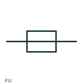

# ANSI/IEEE fuse symbol

IEEE-oriented graphical reference for fuse, with public vendor evidence and drawing-reading notes.

[Canonical reference](https://eloragrid.ai/symbols/ansi-fuse) · [Structured record](../entries/ansi-fuse.json) · [All references](README.md)

Updated: 2026-10-27. Drawing use: SLD, Schematic. Reference families: IEEE / ANSI, Manufacturer.

Graphical convention: IEEE / ANSI. Autodesk IEEE-oriented Fuses functional form.

## What it represents

The fuse representation identifies a sacrificial protective element in a conductor path. The drawing requires its fuse designation and selected link data; a compact outline cannot establish the time-current category, voltage rating or breaking capacity.
This is a convention-specific lookup based on the publisher's IEEE-labelled preview. The geometry here is independently drawn to explain the connection or operation; it is not a certified reproduction of the standard graphic.

## How to read it

- Trace the conductor through the protective element rather than treating its outline as a terminal.
- Read the selected library and the project legend together. A vendor block identifier is meaningful within its named library and is not a universal standard-symbol code.

## Drawing checklist

- State fuse category
- Record current/voltage rating
- Reference breaking and coordination data

## Important distinction

A fuse graphic represents a fuse-link function; a fuse-switch includes an operating assembly as well.

## Facts

- Convention evidence: Autodesk IEEE Symbol Preview — Fuses
- Public vendor block name: HFU1 (Autodesk identifier; not an IEEE symbol number)
- Standards context: IEEE/ANSI 315-1975 covers diagram graphics. IEEE lists this edition as Inactive-Reserved.
- Artwork scope: Original functional illustration; exact standard glyph and compliance are not certified

## Public references

- [Autodesk IEEE Symbol Preview — Fuses](https://help.autodesk.com/cloudhelp/2021/ENU/AutoCAD-Electrical/files/GUID-5CF1E8F7-6883-4C9B-9BB3-6CD1A9339AE5.htm) — Autodesk. Exact public IEEE-oriented category page verifying the component name and vendor block identifier.
- [IEEE/ANSI 315-1975: graphic symbols for electrical and electronics diagrams](https://standards.ieee.org/ieee/315/515/) — IEEE Standards Association. Graphic-symbol standards context and official status; not a source of reproduced artwork.

## Related references

- [Fuse](fuse.md)
- [Circuit breaker](circuit-breaker.md)
- [Load-break switch](load-break-switch.md)
- [Terminal connection](terminal.md)

Original educational concept geometry, CC BY 4.0. Unitless; not a certified standards glyph or manufacturer footprint.

Elora-authored explanations are CC BY 4.0. Linked standards and manufacturer material retain their own rights. Confirm project requirements using primary sources.
