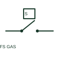

# ANSI/IEEE Gas flow switch form

IEEE-library form of gas flow switch: a gas-flow switch changes contact state for a specified gas-flow condition.

[Canonical reference](https://eloragrid.ai/symbols/ansi-gas-flow-switch) · [Structured record](../entries/ansi-gas-flow-switch.json) · [All references](README.md)

Updated: 2026-10-28. Drawing use: Schematic. Reference families: IEEE / ANSI, Manufacturer.

Graphical convention: IEEE / ANSI. Flow Switch Normally Open - Gas.

## What it represents

This reference locates gas flow switch in Autodesk's IEEE-oriented miscellaneous switches family. A gas-flow switch changes contact state for a specified gas-flow condition. Its process connection and operating requirement belong in the equipment schedule as well as the control logic. The public library uses HFS11S20 for its horizontal representation; this is a vendor block name, not an IEEE standards symbol number.
Read the operating mechanism and the contact reference state together. Cross-reference every associated contact to the same device and show which movement, signal or reset changes its condition; the symbol alone does not establish the complete switching sequence.
Do not substitute liquid-flow characteristics for the selected gas device. Gas-flow actuation is a process-specific input and is separate from the contact's electrical rating. The linked functional counterpart explains the same operating role in its own drawing context; agreement of every detailed convention mark is not asserted.

## How to read it

- Do not substitute liquid-flow characteristics for the selected gas device.
- The preview is an original explanation of this function. Match the actual drawing convention to its legend and the selected equipment documentation.

## Drawing checklist

- Identify gas service
- Record operating condition
- Reference contact and reset action

## Important distinction

Gas-flow actuation is a process-specific input and is separate from the contact's electrical rating.

## Facts

- Convention evidence: Autodesk IEEE Symbol Preview: Miscellaneous Switches; published form: Flow Switch Normally Open - Gas.
- Public vendor block: HFS11S20. Vendor library token, not an IEEE symbol number.
- Drawing role: Actuated indication
- Identifier status: The short label is a functional lookup label, not an assigned IEC or IEEE symbol number. Any separately listed Autodesk code is a verified vendor block name.
- Artwork scope: Original educational geometry. Exact standard graphics, product ratings and terminal pinouts are not certified.

## Public references

- [Autodesk IEEE Symbol Preview — Miscellaneous Switches](https://help.autodesk.com/cloudhelp/2021/ENU/AutoCAD-Electrical/files/GUID-278F6C21-B1A6-4EA1-A535-E78D53BBD10D.htm) — Autodesk. Public IEEE-oriented Miscellaneous Switches table explicitly lists HFS11S20 as Flow Switch Normally Open - Gas. This supports the vendor convention context, not reproduction of the publisher graphic.

## Related references

- [Gas flow switch](gas-flow-switch.md)
- [PLC input / output](plc-io.md)
- [Normally open contact](normally-open-contact.md)

Original educational concept geometry, CC BY 4.0. Unitless; not a certified standards glyph or manufacturer footprint.

Elora-authored explanations are CC BY 4.0. Linked standards and manufacturer material retain their own rights. Confirm project requirements using primary sources.
