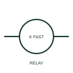

# ANSI/IEEE High-speed relay form

IEEE-library form of high-speed relay: a high-speed relay has a documented operating response intended for duties where relay timing matters.

[Canonical reference](https://eloragrid.ai/symbols/ansi-high-speed-relay) · [Structured record](../entries/ansi-high-speed-relay.json) · [All references](README.md)

Updated: 2026-10-28. Drawing use: Schematic. Reference families: IEEE / ANSI, Manufacturer.

Graphical convention: IEEE / ANSI. High Speed.

## What it represents

This reference locates high-speed relay in Autodesk's IEEE-oriented relays and contacts family. A high-speed relay has a documented operating response intended for duties where relay timing matters. Schematics need the specific model and circuit role rather than an unqualified speed claim. The public library uses HCR1HSP for its horizontal representation; this is a vendor block name, not an IEEE standards symbol number.
Trace the measured quantity or initiating control signal separately from the output contacts. The device tag links the sensing or operating element to the controlled circuit; settings, reset behaviour and the actual terminal arrangement belong in the selected equipment documentation.
Read operate and release times under the specified coil and contact conditions. High-speed classification does not imply a complete protection scheme's total clearing time. The linked functional counterpart explains the same operating role in its own drawing context; agreement of every detailed convention mark is not asserted.

## How to read it

- Read operate and release times under the specified coil and contact conditions.
- The preview is an original explanation of this function. Match the actual drawing convention to its legend and the selected equipment documentation.

## Drawing checklist

- Name relay model
- Reference operate and release data
- Show controlled circuit

## Important distinction

High-speed classification does not imply a complete protection scheme's total clearing time.

## Facts

- Convention evidence: Autodesk IEEE Symbol Preview: Relays and Contacts; published form: High Speed.
- Public vendor block: HCR1HSP. Vendor library token, not an IEEE symbol number.
- Drawing role: Relay operation
- Identifier status: The short label is a functional lookup label, not an assigned IEC or IEEE symbol number. Any separately listed Autodesk code is a verified vendor block name.
- Artwork scope: Original educational geometry. Exact standard graphics, product ratings and terminal pinouts are not certified.

## Public references

- [Autodesk IEEE Symbol Preview — Relays and Contacts](https://help.autodesk.com/cloudhelp/2021/ENU/AutoCAD-Electrical/files/GUID-F8EAC387-53CF-45FE-BE6A-C0C8FB3C1B22.htm) — Autodesk. Public IEEE-oriented Relays and Contacts table explicitly lists HCR1HSP as High Speed. This supports the vendor convention context, not reproduction of the publisher graphic.

## Related references

- [High-speed relay](high-speed-relay.md)
- [Relay coil](relay-coil.md)
- [Normally open contact](normally-open-contact.md)

Original educational concept geometry, CC BY 4.0. Unitless; not a certified standards glyph or manufacturer footprint.

Elora-authored explanations are CC BY 4.0. Linked standards and manufacturer material retain their own rights. Confirm project requirements using primary sources.
