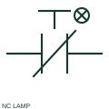

# ANSI/IEEE illuminated normally-closed pushbutton symbol

IEEE-oriented graphical reference for illuminated normally-closed pushbutton, with public vendor evidence and drawing-reading notes.

[Canonical reference](https://eloragrid.ai/symbols/ansi-illuminated-normally-closed-pushbutton) · [Structured record](../entries/ansi-illuminated-normally-closed-pushbutton.json) · [All references](README.md)

Updated: 2026-10-27. Drawing use: Schematic. Reference families: IEEE / ANSI, Manufacturer.

Graphical convention: IEEE / ANSI. Autodesk IEEE-oriented Illuminated Push Buttons functional form.

## What it represents

The illuminated NC pushbutton form retains a normally-closed contact reference while adding a separate visual indication function. Circuit interpretation must establish both the switched control path and the condition energising the lamp.
This is a convention-specific lookup based on the publisher's IEEE-labelled preview. The geometry here is independently drawn to explain the connection or operation; it is not a certified reproduction of the standard graphic.

## How to read it

- A lit actuator does not prove that its contact is open or closed.
- Read the selected library and the project legend together. A vendor block identifier is meaningful within its named library and is not a universal standard-symbol code.

## Drawing checklist

- State contact reference state
- Show lamp terminals
- Name indication meaning

## Important distinction

Contact state and lamp state are two separately documented properties of the same assembly.

## Facts

- Convention evidence: Autodesk IEEE Symbol Preview — Illuminated Push Buttons
- Public vendor block name: HPB12S75 (Autodesk identifier; not an IEEE symbol number)
- Standards context: IEEE/ANSI 315-1975 covers diagram graphics. IEEE lists this edition as Inactive-Reserved.
- Artwork scope: Original functional illustration; exact standard glyph and compliance are not certified

## Public references

- [Autodesk IEEE Symbol Preview — Illuminated Push Buttons](https://help.autodesk.com/cloudhelp/2021/ENU/AutoCAD-Electrical/files/GUID-F7EFADE2-2944-42A1-A5B7-DB6B64694806.htm) — Autodesk. Exact public IEEE-oriented category page verifying the component name and vendor block identifier.
- [IEEE/ANSI 315-1975: graphic symbols for electrical and electronics diagrams](https://standards.ieee.org/ieee/315/515/) — IEEE Standards Association. Graphic-symbol standards context and official status; not a source of reproduced artwork.

## Related references

- [Illuminated normally-closed pushbutton](illuminated-normally-closed-pushbutton.md)
- [Normally open pushbutton](pushbutton-no.md)
- [Normally closed pushbutton](pushbutton-nc.md)

Original educational concept geometry, CC BY 4.0. Unitless; not a certified standards glyph or manufacturer footprint.

Elora-authored explanations are CC BY 4.0. Linked standards and manufacturer material retain their own rights. Confirm project requirements using primary sources.
