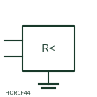

# ANSI/IEEE Insulation monitoring relay form

IEEE-library form of insulation monitoring relay: relay that continuously checks insulation resistance of an unearthed (IT) system to earth and alarms on a first fault.

[Canonical reference](https://eloragrid.ai/symbols/ansi-insulation-monitoring-relay) · [Structured record](../entries/ansi-insulation-monitoring-relay.json) · [All references](README.md)

Updated: 2026-10-28. Drawing use: Schematic, SLD. Reference families: IEEE / ANSI, Manufacturer.

Graphical convention: IEEE / ANSI. Insulating Relay.

## What it represents

This reference locates insulation monitoring relay in Autodesk's IEEE-oriented miscellaneous relays family. An insulation monitoring relay is connected between the conductors of an unearthed (IT) system and earth, and injects a measuring signal to determine insulation resistance. It warns when insulation falls below its setting so a first fault can be located before a second fault causes a trip. The public library uses HCR1F44 for its horizontal representation; this is a vendor block name, not an IEEE standards symbol number.
Trace the measured quantity or initiating control signal separately from the output contacts. The device tag links the sensing or operating element to the controlled circuit; settings, reset behaviour and the actual terminal arrangement belong in the selected equipment documentation.
The symbol shows the device and its connections but not the measuring method, which matters on systems with drives or large DC components. Only one insulation monitor should normally be active on a galvanically connected system, so the drawing should show any disconnection or interlock between parallel systems. Check that only one monitor is active on each connected IT system. An insulation monitoring relay measures insulation resistance of an unearthed system; a residual current monitor measures leakage current in an earthed system. The linked functional counterpart explains the same operating role in its own drawing context; agreement of every detailed convention mark is not asserted.

## How to read it

- Check that only one monitor is active on each connected IT system.
- Identify alarm outputs and test button wiring.

## Drawing checklist

- Show system and earth connections
- State alarm thresholds
- Reference interlock between parallel monitors

## Important distinction

An insulation monitoring relay measures insulation resistance of an unearthed system; a residual current monitor measures leakage current in an earthed system.

## Facts

- Convention evidence: Autodesk IEEE Symbol Preview: Miscellaneous Relays; published form: Insulating Relay.
- Public vendor block: HCR1F44. Vendor library token, not an IEEE symbol number.
- Measured quantity: Insulation resistance to earth
- Preview: Independent educational concept; consult the publisher and applicable standard for the exact graphic
- Artwork scope: Original educational geometry. Exact standard graphics, product ratings and terminal pinouts are not certified.

## Public references

- [Autodesk IEEE Symbol Preview: Miscellaneous Relays](https://help.autodesk.com/cloudhelp/2021/ENU/AutoCAD-Electrical/files/GUID-DA549E3E-4ABB-426E-9331-0226EF55EAA7.htm) — Autodesk. Public IEEE-oriented Miscellaneous Relays table explicitly lists HCR1F44 as Insulating Relay. This supports the vendor convention context, not reproduction of the publisher graphic.
- [IEC graphical symbols for diagrams](https://tc3.iec.ch/tc-activity/graphical-symbols-for-diagrams/) — IEC. IEC context for graphical symbols used in diagrams; no IEC graphic is reproduced.

## Related references

- [Insulation monitoring relay](insulation-monitoring-relay.md)
- [Insulation-failure indication](iec-insulation-failure-indication.md)
- [Residual current monitor](residual-current-monitor.md)
- [Earth-fault voltage relay](earth-fault-voltage-relay.md)

Original educational concept geometry, CC BY 4.0. Unitless; not a certified standards glyph or manufacturer footprint.

Elora-authored explanations are CC BY 4.0. Linked standards and manufacturer material retain their own rights. Confirm project requirements using primary sources.
