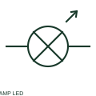

# ANSI/IEEE led indicator lamp symbol

IEEE-oriented graphical reference for led indicator lamp, with public vendor evidence and drawing-reading notes.

[Canonical reference](https://eloragrid.ai/symbols/ansi-led-indicator-lamp) · [Structured record](../entries/ansi-led-indicator-lamp.json) · [All references](README.md)

Updated: 2026-10-27. Drawing use: Schematic. Reference families: IEEE / ANSI, Manufacturer.

Graphical convention: IEEE / ANSI. Autodesk IEEE-oriented LEDs functional form.

## What it represents

The LED indicator form identifies a documented panel indication assembly using a light-emitting semiconductor. Its rated input and any polarity requirement belong to the complete assembly rather than to an assumed bare LED.
This is a convention-specific lookup based on the publisher's IEEE-labelled preview. The geometry here is independently drawn to explain the connection or operation; it is not a certified reproduction of the standard graphic.

## How to read it

- Read the assembly terminal and supply data.
- Read the selected library and the project legend together. A vendor block identifier is meaningful within its named library and is not a universal standard-symbol code.

## Drawing checklist

- State indicator voltage
- Preserve specified polarity
- Name visual signal meaning

## Important distinction

A panel LED indicator may contain internal limiting or protection components absent from a bare LED symbol.

## Facts

- Convention evidence: Autodesk IEEE Symbol Preview — LEDs
- Public vendor block name: HLT1H25 (Autodesk identifier; not an IEEE symbol number)
- Standards context: IEEE/ANSI 315-1975 covers diagram graphics. IEEE lists this edition as Inactive-Reserved.
- Artwork scope: Original functional illustration; exact standard glyph and compliance are not certified

## Public references

- [Autodesk IEEE Symbol Preview — LEDs](https://help.autodesk.com/cloudhelp/2021/ENU/AutoCAD-Electrical/files/GUID-21296086-A519-4A08-B8AC-0AFF670B8F53.htm) — Autodesk. Exact public IEEE-oriented category page verifying the component name and vendor block identifier.
- [IEEE/ANSI 315-1975: graphic symbols for electrical and electronics diagrams](https://standards.ieee.org/ieee/315/515/) — IEEE Standards Association. Graphic-symbol standards context and official status; not a source of reproduced artwork.

## Related references

- [LED indicator lamp](led-indicator-lamp.md)
- [Indicator lamp](indicator-lamp.md)
- [Relay coil](relay-coil.md)

Original educational concept geometry, CC BY 4.0. Unitless; not a certified standards glyph or manufacturer footprint.

Elora-authored explanations are CC BY 4.0. Linked standards and manufacturer material retain their own rights. Confirm project requirements using primary sources.
