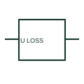

# ANSI/IEEE Loss-of-voltage monitoring relay form

IEEE-library form of loss-of-voltage monitoring relay: a loss-of-voltage relay changes its output for a documented absence-of-voltage condition.

[Canonical reference](https://eloragrid.ai/symbols/ansi-loss-of-voltage-monitoring-relay) · [Structured record](../entries/ansi-loss-of-voltage-monitoring-relay.json) · [All references](README.md)

Updated: 2026-10-28. Drawing use: SLD, Schematic. Reference families: IEEE / ANSI, Manufacturer.

Graphical convention: IEEE / ANSI. Lack of Voltage Protection.

## What it represents

This reference locates loss-of-voltage monitoring relay in Autodesk's IEEE-oriented voltage protection relays family. A loss-of-voltage relay changes its output for a documented absence-of-voltage condition. Schematics distinguish measurement failure, actual source loss and auxiliary-supply loss where the design requires them. The public library uses HCR1F39 for its horizontal representation; this is a vendor block name, not an IEEE standards symbol number.
Trace the measured quantity or initiating control signal separately from the output contacts. The device tag links the sensing or operating element to the controlled circuit; settings, reset behaviour and the actual terminal arrangement belong in the selected equipment documentation.
Trace the monitored voltage independently from relay auxiliary power. Loss-of-voltage indication is not necessarily the same function as breaker undervoltage release. The linked functional counterpart explains the same operating role in its own drawing context; agreement of every detailed convention mark is not asserted.

## How to read it

- Trace the monitored voltage independently from relay auxiliary power.
- The preview is an original explanation of this function. Match the actual drawing convention to its legend and the selected equipment documentation.

## Drawing checklist

- Identify monitored source
- State loss criterion
- Show output and supply-loss behaviour

## Important distinction

Loss-of-voltage indication is not necessarily the same function as breaker undervoltage release.

## Facts

- Convention evidence: Autodesk IEEE Symbol Preview: Voltage Protection Relays; published form: Lack of Voltage Protection.
- Public vendor block: HCR1F39. Vendor library token, not an IEEE symbol number.
- Drawing role: Monitoring element
- Identifier status: The short label is a functional lookup label, not an assigned IEC or IEEE symbol number. Any separately listed Autodesk code is a verified vendor block name.
- Artwork scope: Original educational geometry. Exact standard graphics, product ratings and terminal pinouts are not certified.

## Public references

- [Autodesk IEEE Symbol Preview: Voltage Protection Relays](https://help.autodesk.com/cloudhelp/2021/ENU/AutoCAD-Electrical/files/GUID-5D942536-ADE3-43EA-8280-CC7907C38F15.htm) — Autodesk. Public IEEE-oriented Voltage Protection Relays table explicitly lists HCR1F39 as Lack of Voltage Protection. This supports the vendor convention context, not reproduction of the publisher graphic.

## Related references

- [Loss-of-voltage monitoring relay](loss-of-voltage-monitoring-relay.md)
- [Current transformer](current-transformer.md)
- [Relay coil](relay-coil.md)

Original educational concept geometry, CC BY 4.0. Unitless; not a certified standards glyph or manufacturer footprint.

Elora-authored explanations are CC BY 4.0. Linked standards and manufacturer material retain their own rights. Confirm project requirements using primary sources.
