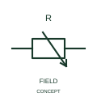

# ANSI/IEEE Magnetoresistive element form

IEEE-library form of magnetoresistive element: this representation identifies a resistive element whose response is associated with a magnetic field.

[Canonical reference](https://eloragrid.ai/symbols/ansi-magnetoresistive-element) · [Structured record](../entries/ansi-magnetoresistive-element.json) · [All references](README.md)

Updated: 2026-10-28. Drawing use: Schematic. Reference families: IEEE / ANSI, Manufacturer.

Graphical convention: IEEE / ANSI. Magnetoresistor.

## What it represents

This reference locates magnetoresistive element in Autodesk's IEEE-oriented resistive components family. This representation identifies a resistive element whose response is associated with a magnetic field. The component is a resistive sensing element associated with a magnetic field. It can participate in a larger measurement circuit rather than providing a ready-made contact output. The public library uses HVR1S00689 for its horizontal representation; this is a vendor block name, not an IEEE standards symbol number.
Follow the actual current path and terminal polarity in the surrounding circuit. The symbol identifies an electrical function; voltage, current, energy limits and the device package pinout come from the selected component data rather than from the outline.
Identify any bridge, conditioning or controller input associated with the element. A magnetically operated switch has a different electrical output description. Document the sensing circuit and output conditioning separately. A magnetoresistive element is distinct from a magnetic contact switch. The linked functional counterpart explains the same operating role in its own drawing context; agreement of every detailed convention mark is not asserted.

## How to read it

- Document the sensing circuit and output conditioning separately.
- A magnetoresistive element is distinct from a magnetic contact switch.

## Drawing checklist

- Identify the associated device, circuit or diagram boundary.
- Document the sensing circuit and output conditioning separately.
- Cross-reference the equipment data, terminal mapping or operating-state legend needed to interpret the form.

## Important distinction

A magnetoresistive element is distinct from a magnetic contact switch.

## Facts

- Convention evidence: Autodesk IEEE Symbol Preview: Resistive Components; published form: Magnetoresistor.
- Public vendor block: HVR1S00689. Vendor library token, not an IEEE symbol number.
- Information added: Document the sensing circuit and output conditioning separately.
- Preview: Independent educational concept; consult the publisher and applicable standard for the exact graphic
- Artwork scope: Original educational geometry. Exact standard graphics, product ratings and terminal pinouts are not certified.

## Public references

- [Autodesk IEEE Symbol Preview — Resistive Components](https://help.autodesk.com/cloudhelp/2021/ENU/AutoCAD-Electrical/files/GUID-1A45DE3A-CD2A-4AD9-8125-219905C870B1.htm) — Autodesk. Public IEEE-oriented Resistive Components table explicitly lists HVR1S00689 as Magnetoresistor. This supports the vendor convention context, not reproduction of the publisher graphic.

## Related references

- [Magnetoresistive element](iec-magnetoresistive-element.md)
- [Resistor](resistor.md)
- [Capacitor](capacitor.md)

Original educational concept geometry, CC BY 4.0. Unitless; not a certified standards glyph or manufacturer footprint.

Elora-authored explanations are CC BY 4.0. Linked standards and manufacturer material retain their own rights. Confirm project requirements using primary sources.
