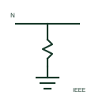

# ANSI/IEEE main bonding jumper symbol

US-practice bonding jumper between the grounded neutral and the equipment grounding system at the service.

[Canonical reference](https://eloragrid.ai/symbols/ansi-main-bonding-jumper) · [Structured record](../entries/ansi-main-bonding-jumper.json) · [All references](README.md)

Updated: 2026-10-28. Drawing use: SLD, Schematic. Reference families: IEEE / ANSI.

Graphical convention: IEEE / ANSI. Main bonding jumper form.

## What it represents

In North American practice the main bonding jumper connects the grounded conductor, the neutral, to the equipment grounding conductor and enclosure at the service equipment. Its function corresponds to the neutral-to-earth link in TN-C-S systems. Single-line diagrams show it at the service disconnect, and separately derived systems have a corresponding system bonding jumper.
This illustration is an independent explanation and not an IEEE graphic. Only one bond should exist per service or separately derived system. Sizing rules come from the applicable electrical code, and the drawing should state the conductor or strap size.

## How to read it

- Locate the bond at the service or derived system source only.
- Check for unwanted downstream neutral to ground bonds.

## Drawing checklist

- Show the jumper at the service equipment.
- State jumper size.
- Show system bonding jumpers on separately derived systems.

## Important distinction

A main bonding jumper bonds neutral and ground at the service; an equipment bonding jumper bonds metal parts together.

## Facts

- Convention evidence: IEEE 315 graphic conventions for ground and bonding (standards context only)
- Equivalent concept: Neutral to earth link in TN-C-S practice
- Standards context: IEEE/ANSI 315-1975 covers diagram graphics; IEEE lists this edition as Inactive-Reserved.
- Preview: Original educational illustration; consult the publisher and applicable standard for the exact graphic

## Public references

- [IEEE/ANSI 315-1975: graphic symbols for electrical and electronics diagrams](https://standards.ieee.org/ieee/315/515/) — IEEE Standards Association. Graphic-symbol standards context and official status; not a source of reproduced artwork.
- [Autodesk IEEE Symbol Preview — Miscellaneous](https://help.autodesk.com/cloudhelp/2021/ENU/AutoCAD-Electrical/files/GUID-34282BFD-7B8E-48F3-A6ED-93ADBDDDFBD3.htm) — Autodesk. Public IEEE-oriented earth and bonding forms.

## Related references

- [Neutral-to-earth link](iec-men-link.md)
- [ANSI/IEEE protective earth symbol](ansi-protective-earth.md)
- [ANSI/IEEE protective equipotential bonding symbol](ansi-protective-equipotential-bonding.md)

Original educational concept geometry, CC BY 4.0. Unitless; not a certified standards glyph or manufacturer footprint.

Elora-authored explanations are CC BY 4.0. Linked standards and manufacturer material retain their own rights. Confirm project requirements using primary sources.
