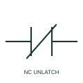

# ANSI/IEEE Manually unlatched NC contact form

IEEE-library form of manually unlatched nc contact: a manually unlatched NC contact has a mechanical retained state and a documented manual release.

[Canonical reference](https://eloragrid.ai/symbols/ansi-manually-unlatched-nc-contact) · [Structured record](../entries/ansi-manually-unlatched-nc-contact.json) · [All references](README.md)

Updated: 2026-10-28. Drawing use: Schematic. Reference families: IEEE / ANSI, Manufacturer.

Graphical convention: IEEE / ANSI. With Mechanical Block and Manual Unlatching.

## What it represents

This reference locates manually unlatched nc contact in Autodesk's IEEE-oriented relays and contacts family. A manually unlatched NC contact has a mechanical retained state and a documented manual release. Its reference state is closed but the retained operated position must be stated. The public library uses HCR2221F for its horizontal representation; this is a vendor block name, not an IEEE standards symbol number.
Trace the measured quantity or initiating control signal separately from the output contacts. The device tag links the sensing or operating element to the controlled circuit; settings, reset behaviour and the actual terminal arrangement belong in the selected equipment documentation.
Confirm which contact position the mechanism retains. A mechanical retention marker must not be confused with a delayed-return timer marker. The linked functional counterpart explains the same operating role in its own drawing context; agreement of every detailed convention mark is not asserted.

## How to read it

- Confirm which contact position the mechanism retains.
- The preview is an original explanation of this function. Match the actual drawing convention to its legend and the selected equipment documentation.

## Drawing checklist

- State reference and retained states
- Identify manual release
- Link associated device

## Important distinction

A mechanical retention marker must not be confused with a delayed-return timer marker.

## Facts

- Convention evidence: Autodesk IEEE Symbol Preview: Relays and Contacts; published form: With Mechanical Block and Manual Unlatching.
- Public vendor block: HCR2221F. Vendor library token, not an IEEE symbol number.
- Drawing role: Contact state
- Identifier status: The short label is a functional lookup label, not an assigned IEC or IEEE symbol number. Any separately listed Autodesk code is a verified vendor block name.
- Artwork scope: Original educational geometry. Exact standard graphics, product ratings and terminal pinouts are not certified.

## Public references

- [Autodesk IEEE Symbol Preview — Relays and Contacts](https://help.autodesk.com/cloudhelp/2021/ENU/AutoCAD-Electrical/files/GUID-F8EAC387-53CF-45FE-BE6A-C0C8FB3C1B22.htm) — Autodesk. Public IEEE-oriented Relays and Contacts table explicitly lists HCR2221F as With Mechanical Block and Manual Unlatching. This supports the vendor convention context, not reproduction of the publisher graphic.

## Related references

- [Manually unlatched NC contact](manually-unlatched-nc-contact.md)
- [Normally open contact](normally-open-contact.md)
- [Normally closed contact](normally-closed-contact.md)

Original educational concept geometry, CC BY 4.0. Unitless; not a certified standards glyph or manufacturer footprint.

Elora-authored explanations are CC BY 4.0. Linked standards and manufacturer material retain their own rights. Confirm project requirements using primary sources.
