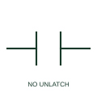

# ANSI/IEEE Manually unlatched NO contact form

IEEE-library form of manually unlatched no contact: a manually unlatched NO contact includes a mechanical retaining action released by a documented manual operation.

[Canonical reference](https://eloragrid.ai/symbols/ansi-manually-unlatched-no-contact) · [Structured record](../entries/ansi-manually-unlatched-no-contact.json) · [All references](README.md)

Updated: 2026-10-28. Drawing use: Schematic. Reference families: IEEE / ANSI, Manufacturer.

Graphical convention: IEEE / ANSI. With Mechanical Block and Manual Unlatching.

## What it represents

This reference locates manually unlatched no contact in Autodesk's IEEE-oriented relays and contacts family. A manually unlatched NO contact includes a mechanical retaining action released by a documented manual operation. Its schematic modifier explains why removal of an initiating signal may not restore the initial state. The public library uses HCR2121F for its horizontal representation; this is a vendor block name, not an IEEE standards symbol number.
Trace the measured quantity or initiating control signal separately from the output contacts. The device tag links the sensing or operating element to the controlled circuit; settings, reset behaviour and the actual terminal arrangement belong in the selected equipment documentation.
Follow the manual reset to the retaining device tag. Manual unlatching concerns the mechanism, not the contact's load interrupting rating. The linked functional counterpart explains the same operating role in its own drawing context; agreement of every detailed convention mark is not asserted.

## How to read it

- Follow the manual reset to the retaining device tag.
- The preview is an original explanation of this function. Match the actual drawing convention to its legend and the selected equipment documentation.

## Drawing checklist

- Identify latch mechanism
- Show manual unlatch
- Reference contact terminals

## Important distinction

Manual unlatching concerns the mechanism, not the contact's load interrupting rating.

## Facts

- Convention evidence: Autodesk IEEE Symbol Preview: Relays and Contacts; published form: With Mechanical Block and Manual Unlatching.
- Public vendor block: HCR2121F. Vendor library token, not an IEEE symbol number.
- Drawing role: Contact state
- Identifier status: The short label is a functional lookup label, not an assigned IEC or IEEE symbol number. Any separately listed Autodesk code is a verified vendor block name.
- Artwork scope: Original educational geometry. Exact standard graphics, product ratings and terminal pinouts are not certified.

## Public references

- [Autodesk IEEE Symbol Preview — Relays and Contacts](https://help.autodesk.com/cloudhelp/2021/ENU/AutoCAD-Electrical/files/GUID-F8EAC387-53CF-45FE-BE6A-C0C8FB3C1B22.htm) — Autodesk. Public IEEE-oriented Relays and Contacts table explicitly lists HCR2121F as With Mechanical Block and Manual Unlatching. This supports the vendor convention context, not reproduction of the publisher graphic.

## Related references

- [Manually unlatched NO contact](manually-unlatched-no-contact.md)
- [Normally open contact](normally-open-contact.md)
- [Normally closed contact](normally-closed-contact.md)

Original educational concept geometry, CC BY 4.0. Unitless; not a certified standards glyph or manufacturer footprint.

Elora-authored explanations are CC BY 4.0. Linked standards and manufacturer material retain their own rights. Confirm project requirements using primary sources.
