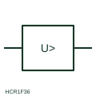

# ANSI/IEEE Maximum-voltage measuring relay form

IEEE-library form of maximum-voltage measuring relay: measuring relay that operates when the monitored voltage rises above its set level.

[Canonical reference](https://eloragrid.ai/symbols/ansi-maximum-voltage-relay) · [Structured record](../entries/ansi-maximum-voltage-relay.json) · [All references](README.md)

Updated: 2026-10-28. Drawing use: Schematic, SLD. Reference families: IEEE / ANSI, Manufacturer.

Graphical convention: IEEE / ANSI. Maximum Voltage Protection.

## What it represents

This reference locates maximum-voltage measuring relay in Autodesk's IEEE-oriented voltage protection relays family. The maximum-voltage relay form operates when voltage exceeds its setting. Typical uses include generator overvoltage after load rejection, capacitor bank protection and inverter connection points, where sustained high voltage can stress insulation or breach grid connection limits. The public library uses HCR1F36 for its horizontal representation; this is a vendor block name, not an IEEE standards symbol number.
Trace the measured quantity or initiating control signal separately from the output contacts. The device tag links the sensing or operating element to the controlled circuit; settings, reset behaviour and the actual terminal arrangement belong in the selected equipment documentation.
The box shows a greater-than voltage threshold but not whether the element uses phase-to-phase or phase-to-neutral quantities, the reset ratio or the time delay. Grid-connection settings are usually specified as several stages with different delays, which this single symbol does not reveal. Identify the voltage connection used by the element. A maximum-voltage relay responds to high voltage magnitude; a residual voltage relay responds to neutral displacement. The linked functional counterpart explains the same operating role in its own drawing context; agreement of every detailed convention mark is not asserted.

## How to read it

- Identify the voltage connection used by the element.
- Check for multiple stages in the settings record.

## Drawing checklist

- State threshold and delay
- Show VT connection
- Reference stage settings

## Important distinction

A maximum-voltage relay responds to high voltage magnitude; a residual voltage relay responds to neutral displacement.

## Facts

- Convention evidence: Autodesk IEEE Symbol Preview: Voltage Protection Relays; published form: Maximum Voltage Protection.
- Public vendor block: HCR1F36. Vendor library token, not an IEEE symbol number.
- Measured quantity: Voltage above a set level
- Preview: Independent educational concept; consult the publisher and applicable standard for the exact graphic
- Artwork scope: Original educational geometry. Exact standard graphics, product ratings and terminal pinouts are not certified.

## Public references

- [Autodesk IEEE Symbol Preview: Voltage Protection Relays](https://help.autodesk.com/cloudhelp/2021/ENU/AutoCAD-Electrical/files/GUID-5D942536-ADE3-43EA-8280-CC7907C38F15.htm) — Autodesk. Public IEEE-oriented Voltage Protection Relays table explicitly lists HCR1F36 as Maximum Voltage Protection. This supports the vendor convention context, not reproduction of the publisher graphic.
- [IEC graphical symbols for diagrams](https://tc3.iec.ch/tc-activity/graphical-symbols-for-diagrams/) — IEC. IEC context for graphical symbols used in diagrams; no IEC graphic is reproduced.

## Related references

- [Maximum-voltage measuring relay](maximum-voltage-relay.md)
- [Minimum-voltage measuring relay](minimum-voltage-relay.md)
- [Overvoltage](59-overvoltage.md)
- [Voltage transformer](voltage-transformer.md)

Original educational concept geometry, CC BY 4.0. Unitless; not a certified standards glyph or manufacturer footprint.

Elora-authored explanations are CC BY 4.0. Linked standards and manufacturer material retain their own rights. Confirm project requirements using primary sources.
