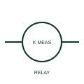

# ANSI/IEEE Measuring relay form

IEEE-library form of measuring relay: a measuring relay responds to a measured electrical quantity and issues an output according to its configuration.

[Canonical reference](https://eloragrid.ai/symbols/ansi-measuring-relay) · [Structured record](../entries/ansi-measuring-relay.json) · [All references](README.md)

Updated: 2026-10-28. Drawing use: Schematic. Reference families: IEEE / ANSI, Manufacturer.

Graphical convention: IEEE / ANSI. Measuring.

## What it represents

This reference locates measuring relay in Autodesk's IEEE-oriented relays and contacts family. A measuring relay responds to a measured electrical quantity and issues an output according to its configuration. Measurement inputs, auxiliary supply and output contacts may be separate terminal groups. The public library uses HCR1MSR for its horizontal representation; this is a vendor block name, not an IEEE standards symbol number.
Trace the measured quantity or initiating control signal separately from the output contacts. The device tag links the sensing or operating element to the controlled circuit; settings, reset behaviour and the actual terminal arrangement belong in the selected equipment documentation.
Identify the measured quantity before tracing the output contact logic. A measuring relay is not simply a coil powered by the same quantity it measures. The linked functional counterpart explains the same operating role in its own drawing context; agreement of every detailed convention mark is not asserted.

## How to read it

- Identify the measured quantity before tracing the output contact logic.
- The preview is an original explanation of this function. Match the actual drawing convention to its legend and the selected equipment documentation.

## Drawing checklist

- Label measured input
- State auxiliary supply
- Reference threshold or setting record

## Important distinction

A measuring relay is not simply a coil powered by the same quantity it measures.

## Facts

- Convention evidence: Autodesk IEEE Symbol Preview: Relays and Contacts; published form: Measuring.
- Public vendor block: HCR1MSR. Vendor library token, not an IEEE symbol number.
- Drawing role: Relay operation
- Identifier status: The short label is a functional lookup label, not an assigned IEC or IEEE symbol number. Any separately listed Autodesk code is a verified vendor block name.
- Artwork scope: Original educational geometry. Exact standard graphics, product ratings and terminal pinouts are not certified.

## Public references

- [Autodesk IEEE Symbol Preview — Relays and Contacts](https://help.autodesk.com/cloudhelp/2021/ENU/AutoCAD-Electrical/files/GUID-F8EAC387-53CF-45FE-BE6A-C0C8FB3C1B22.htm) — Autodesk. Public IEEE-oriented Relays and Contacts table explicitly lists HCR1MSR as Measuring. This supports the vendor convention context, not reproduction of the publisher graphic.

## Related references

- [Measuring relay](measuring-relay.md)
- [Relay coil](relay-coil.md)
- [Normally open contact](normally-open-contact.md)

Original educational concept geometry, CC BY 4.0. Unitless; not a certified standards glyph or manufacturer footprint.

Elora-authored explanations are CC BY 4.0. Linked standards and manufacturer material retain their own rights. Confirm project requirements using primary sources.
