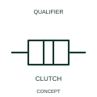

# ANSI/IEEE Mechanical clutch connection form

IEEE-library form of mechanical clutch connection: a clutch qualifier identifies a selectively coupled mechanical relationship.

[Canonical reference](https://eloragrid.ai/symbols/ansi-mechanical-clutch-connection) · [Structured record](../entries/ansi-mechanical-clutch-connection.json) · [All references](README.md)

Updated: 2026-10-28. Drawing use: Schematic. Reference families: IEEE / ANSI, Manufacturer.

Graphical convention: IEEE / ANSI. Clutch Joint.

## What it represents

This reference locates mechanical clutch connection in Autodesk's IEEE-oriented mechanical controls, coupling family. A clutch qualifier identifies a selectively coupled mechanical relationship. A clutch provides a selectable mechanical relationship between driving and driven elements. Its engaged and disengaged conditions can influence movement without interrupting an electrical supply. The public library uses Q021216 for its horizontal representation; this is a vendor block name, not an IEEE standards symbol number.
Read the operating mechanism and the contact reference state together. Cross-reference every associated contact to the same device and show which movement, signal or reset changes its condition; the symbol alone does not establish the complete switching sequence.
Name the two coupled elements and cross-reference the actuation and position feedback. Mechanical coupling does not imply that the elements share one electrical circuit. Name the driving and driven elements and the coupling control. Mechanical engagement does not mean electrical continuity between the elements. The linked functional counterpart explains the same operating role in its own drawing context; agreement of every detailed convention mark is not asserted.

## How to read it

- Name the driving and driven elements and the coupling control.
- Mechanical engagement does not mean electrical continuity between the elements.

## Drawing checklist

- Identify the associated device, circuit or diagram boundary.
- Name the driving and driven elements and the coupling control.
- Cross-reference the equipment data, terminal mapping or operating-state legend needed to interpret the form.

## Important distinction

Mechanical engagement does not mean electrical continuity between the elements.

## Facts

- Convention evidence: Autodesk IEEE Symbol Preview: Mechanical Controls, Coupling; published form: Clutch Joint.
- Public vendor block: Q021216. Vendor library token, not an IEEE symbol number.
- Information added: Name the driving and driven elements and the coupling control.
- Preview: Independent educational concept; consult the publisher and applicable standard for the exact graphic
- Artwork scope: Original educational geometry. Exact standard graphics, product ratings and terminal pinouts are not certified.

## Public references

- [Autodesk IEEE Symbol Preview: Mechanical Controls, Coupling](https://help.autodesk.com/cloudhelp/2021/ENU/AutoCAD-Electrical/files/GUID-3B784797-C632-4E0A-BCDC-D7E4D982FE34.htm) — Autodesk. Public IEEE-oriented Mechanical Controls, Coupling table explicitly lists Q021216 as Clutch Joint. This supports the vendor convention context, not reproduction of the publisher graphic.

## Related references

- [Mechanical clutch connection](iec-mechanical-clutch-connection.md)
- [Relay coil](relay-coil.md)
- [Normally open contact](normally-open-contact.md)

Original educational concept geometry, CC BY 4.0. Unitless; not a certified standards glyph or manufacturer footprint.

Elora-authored explanations are CC BY 4.0. Linked standards and manufacturer material retain their own rights. Confirm project requirements using primary sources.
