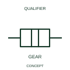

# ANSI/IEEE Mechanical gear connection form

IEEE-library form of mechanical gear connection: a gear-connection indication identifies transmission through a gearing relationship.

[Canonical reference](https://eloragrid.ai/symbols/ansi-mechanical-gear-connection) · [Structured record](../entries/ansi-mechanical-gear-connection.json) · [All references](README.md)

Updated: 2026-10-28. Drawing use: Schematic. Reference families: IEEE / ANSI, Manufacturer.

Graphical convention: IEEE / ANSI. Gear Joint.

## What it represents

This reference locates mechanical gear connection in Autodesk's IEEE-oriented mechanical controls, coupling family. A gear-connection indication identifies transmission through a gearing relationship. A gear relationship transfers motion through the documented gearing arrangement. It can relate an operating member to a switch, position device or driven mechanism. The public library uses Q021223 for its horizontal representation; this is a vendor block name, not an IEEE standards symbol number.
Read the operating mechanism and the contact reference state together. Cross-reference every associated contact to the same device and show which movement, signal or reset changes its condition; the symbol alone does not establish the complete switching sequence.
The schematic identifies the relationship while a mechanical drawing supplies ratio and geometry. Avoid treating the gear connection mark as a numerical reduction ratio. State the driving/driven mechanism and any required ratio in the schedule. The symbol does not give a gear ratio, tooth geometry or mechanical rating. The linked functional counterpart explains the same operating role in its own drawing context; agreement of every detailed convention mark is not asserted.

## How to read it

- State the driving/driven mechanism and any required ratio in the schedule.
- The symbol does not give a gear ratio, tooth geometry or mechanical rating.

## Drawing checklist

- Identify the associated device, circuit or diagram boundary.
- State the driving/driven mechanism and any required ratio in the schedule.
- Cross-reference the equipment data, terminal mapping or operating-state legend needed to interpret the form.

## Important distinction

The symbol does not give a gear ratio, tooth geometry or mechanical rating.

## Facts

- Convention evidence: Autodesk IEEE Symbol Preview: Mechanical Controls, Coupling; published form: Gear Joint.
- Public vendor block: Q021223. Vendor library token, not an IEEE symbol number.
- Information added: State the driving/driven mechanism and any required ratio in the schedule.
- Preview: Independent educational concept; consult the publisher and applicable standard for the exact graphic
- Artwork scope: Original educational geometry. Exact standard graphics, product ratings and terminal pinouts are not certified.

## Public references

- [Autodesk IEEE Symbol Preview: Mechanical Controls, Coupling](https://help.autodesk.com/cloudhelp/2021/ENU/AutoCAD-Electrical/files/GUID-3B784797-C632-4E0A-BCDC-D7E4D982FE34.htm) — Autodesk. Public IEEE-oriented Mechanical Controls, Coupling table explicitly lists Q021223 as Gear Joint. This supports the vendor convention context, not reproduction of the publisher graphic.

## Related references

- [Mechanical gear connection](iec-mechanical-gear-connection.md)
- [Relay coil](relay-coil.md)
- [Normally open contact](normally-open-contact.md)

Original educational concept geometry, CC BY 4.0. Unitless; not a certified standards glyph or manufacturer footprint.

Elora-authored explanations are CC BY 4.0. Linked standards and manufacturer material retain their own rights. Confirm project requirements using primary sources.
