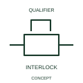

# ANSI/IEEE Mechanical interlock between devices form

IEEE-library form of mechanical interlock between devices: a mechanical interlock indication links devices whose movements are constrained by a physical relationship.

[Canonical reference](https://eloragrid.ai/symbols/ansi-mechanical-interlock-between-devices) · [Structured record](../entries/ansi-mechanical-interlock-between-devices.json) · [All references](README.md)

Updated: 2026-10-28. Drawing use: Schematic. Reference families: IEEE / ANSI, Manufacturer.

Graphical convention: IEEE / ANSI. Interlock Between Two Devices.

## What it represents

This reference locates mechanical interlock between devices in Autodesk's IEEE-oriented mechanical controls family. A mechanical interlock indication links devices whose movements are constrained by a physical relationship. A physical interlock constrains the movements of two associated mechanisms. It remains a mechanical relationship even when the electrical circuit also contains permissive contacts. The public library uses Q021211 for its horizontal representation; this is a vendor block name, not an IEEE standards symbol number.
Read the operating mechanism and the contact reference state together. Cross-reference every associated contact to the same device and show which movement, signal or reset changes its condition; the symbol alone does not establish the complete switching sequence.
Use both device tags and the intended exclusive positions to make the relationship readable. Draw any electrical feedback or auxiliary interlock contact separately, since it represents another interface. Identify both devices and the prohibited simultaneous condition. Mechanical interlocking differs from an electrical interlock contact or software permissive. The linked functional counterpart explains the same operating role in its own drawing context; agreement of every detailed convention mark is not asserted.

## How to read it

- Identify both devices and the prohibited simultaneous condition.
- Mechanical interlocking differs from an electrical interlock contact or software permissive.

## Drawing checklist

- Identify the associated device, circuit or diagram boundary.
- Identify both devices and the prohibited simultaneous condition.
- Cross-reference the equipment data, terminal mapping or operating-state legend needed to interpret the form.

## Important distinction

Mechanical interlocking differs from an electrical interlock contact or software permissive.

## Facts

- Convention evidence: Autodesk IEEE Symbol Preview: Mechanical Controls; published form: Interlock Between Two Devices.
- Public vendor block: Q021211. Vendor library token, not an IEEE symbol number.
- Information added: Identify both devices and the prohibited simultaneous condition.
- Preview: Independent educational concept; consult the publisher and applicable standard for the exact graphic
- Artwork scope: Original educational geometry. Exact standard graphics, product ratings and terminal pinouts are not certified.

## Public references

- [Autodesk IEEE Symbol Preview: Mechanical Controls](https://help.autodesk.com/cloudhelp/2021/ENU/AutoCAD-Electrical/files/GUID-450F6FD7-7A10-4F81-92A1-0D9BECFB23FC.htm) — Autodesk. Public IEEE-oriented Mechanical Controls table explicitly lists Q021211 as Interlock Between Two Devices. This supports the vendor convention context, not reproduction of the publisher graphic.

## Related references

- [Mechanical interlock between devices](iec-mechanical-interlock-between-devices.md)
- [Relay coil](relay-coil.md)
- [Normally open contact](normally-open-contact.md)

Original educational concept geometry, CC BY 4.0. Unitless; not a certified standards glyph or manufacturer footprint.

Elora-authored explanations are CC BY 4.0. Linked standards and manufacturer material retain their own rights. Confirm project requirements using primary sources.
