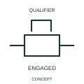

# ANSI/IEEE Mechanical stop latch in engaged state form

IEEE-library form of mechanical stop latch in engaged state: this form identifies an engaged stop-latch mechanism.

[Canonical reference](https://eloragrid.ai/symbols/ansi-mechanical-stop-latch-in-engaged-state) · [Structured record](../entries/ansi-mechanical-stop-latch-in-engaged-state.json) · [All references](README.md)

Updated: 2026-10-28. Drawing use: Schematic. Reference families: IEEE / ANSI, Manufacturer.

Graphical convention: IEEE / ANSI. Stop Latch Engaged.

## What it represents

This reference locates mechanical stop latch in engaged state in Autodesk's IEEE-oriented mechanical controls family. This form identifies an engaged stop-latch mechanism. The state describes mechanical retention. The affected device can have separate electrical contacts reporting that position, so engagement is not equivalent to energisation. The public library uses Q021210 for its horizontal representation; this is a vendor block name, not an IEEE standards symbol number.
Read the operating mechanism and the contact reference state together. Cross-reference every associated contact to the same device and show which movement, signal or reset changes its condition; the symbol alone does not establish the complete switching sequence.
State which movement is restrained and what documented release action changes the condition. Where feedback is used, cross-reference its actual contact rather than treating the latch mark as an electrical output. State which movement is restrained and what releases the latch. An engaged latch does not automatically indicate a circuit is energised. The linked functional counterpart explains the same operating role in its own drawing context; agreement of every detailed convention mark is not asserted.

## How to read it

- State which movement is restrained and what releases the latch.
- An engaged latch does not automatically indicate a circuit is energised.

## Drawing checklist

- Identify the associated device, circuit or diagram boundary.
- State which movement is restrained and what releases the latch.
- Cross-reference the equipment data, terminal mapping or operating-state legend needed to interpret the form.

## Important distinction

An engaged latch does not automatically indicate a circuit is energised.

## Facts

- Convention evidence: Autodesk IEEE Symbol Preview: Mechanical Controls; published form: Stop Latch Engaged.
- Public vendor block: Q021210. Vendor library token, not an IEEE symbol number.
- Information added: State which movement is restrained and what releases the latch.
- Preview: Independent educational concept; consult the publisher and applicable standard for the exact graphic
- Artwork scope: Original educational geometry. Exact standard graphics, product ratings and terminal pinouts are not certified.

## Public references

- [Autodesk IEEE Symbol Preview: Mechanical Controls](https://help.autodesk.com/cloudhelp/2021/ENU/AutoCAD-Electrical/files/GUID-450F6FD7-7A10-4F81-92A1-0D9BECFB23FC.htm) — Autodesk. Public IEEE-oriented Mechanical Controls table explicitly lists Q021210 as Stop Latch Engaged. This supports the vendor convention context, not reproduction of the publisher graphic.

## Related references

- [Mechanical stop latch in engaged state](iec-mechanical-stop-latch-in-engaged-state.md)
- [Relay coil](relay-coil.md)
- [Normally open contact](normally-open-contact.md)

Original educational concept geometry, CC BY 4.0. Unitless; not a certified standards glyph or manufacturer footprint.

Elora-authored explanations are CC BY 4.0. Linked standards and manufacturer material retain their own rights. Confirm project requirements using primary sources.
