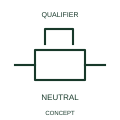

# ANSI/IEEE Mechanical stop latch in neutral state form

IEEE-library form of mechanical stop latch in neutral state: this form identifies the neutral state of the represented stop-latch mechanism.

[Canonical reference](https://eloragrid.ai/symbols/ansi-mechanical-stop-latch-in-neutral-state) · [Structured record](../entries/ansi-mechanical-stop-latch-in-neutral-state.json) · [All references](README.md)

Updated: 2026-10-28. Drawing use: Schematic. Reference families: IEEE / ANSI, Manufacturer.

Graphical convention: IEEE / ANSI. Stop Latch in Neutral Position.

## What it represents

This reference locates mechanical stop latch in neutral state in Autodesk's IEEE-oriented mechanical controls family. This form identifies the neutral state of the represented stop-latch mechanism. Neutral describes the represented retaining mechanism, not every electrical contact belonging to the assembly. A state table provides the relationship between latch condition and contact states. The public library uses Q021209 for its horizontal representation; this is a vendor block name, not an IEEE standards symbol number.
Read the operating mechanism and the contact reference state together. Cross-reference every associated contact to the same device and show which movement, signal or reset changes its condition; the symbol alone does not establish the complete switching sequence.
Identify the associated mechanism and define the neutral condition in its operating sequence. Use separate contact and position references when those interfaces appear elsewhere in the schematic. Keep neutral and engaged states explicit in state or sequence documentation. Neutral is a mechanism state, not an assertion that every contact is open. The linked functional counterpart explains the same operating role in its own drawing context; agreement of every detailed convention mark is not asserted.

## How to read it

- Keep neutral and engaged states explicit in state or sequence documentation.
- Neutral is a mechanism state, not an assertion that every contact is open.

## Drawing checklist

- Identify the associated device, circuit or diagram boundary.
- Keep neutral and engaged states explicit in state or sequence documentation.
- Cross-reference the equipment data, terminal mapping or operating-state legend needed to interpret the form.

## Important distinction

Neutral is a mechanism state, not an assertion that every contact is open.

## Facts

- Convention evidence: Autodesk IEEE Symbol Preview: Mechanical Controls; published form: Stop Latch in Neutral Position.
- Public vendor block: Q021209. Vendor library token, not an IEEE symbol number.
- Information added: Keep neutral and engaged states explicit in state or sequence documentation.
- Preview: Independent educational concept; consult the publisher and applicable standard for the exact graphic
- Artwork scope: Original educational geometry. Exact standard graphics, product ratings and terminal pinouts are not certified.

## Public references

- [Autodesk IEEE Symbol Preview: Mechanical Controls](https://help.autodesk.com/cloudhelp/2021/ENU/AutoCAD-Electrical/files/GUID-450F6FD7-7A10-4F81-92A1-0D9BECFB23FC.htm) — Autodesk. Public IEEE-oriented Mechanical Controls table explicitly lists Q021209 as Stop Latch in Neutral Position. This supports the vendor convention context, not reproduction of the publisher graphic.

## Related references

- [Mechanical stop latch in neutral state](iec-mechanical-stop-latch-in-neutral-state.md)
- [Relay coil](relay-coil.md)
- [Normally open contact](normally-open-contact.md)

Original educational concept geometry, CC BY 4.0. Unitless; not a certified standards glyph or manufacturer footprint.

Elora-authored explanations are CC BY 4.0. Linked standards and manufacturer material retain their own rights. Confirm project requirements using primary sources.
