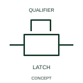

# ANSI/IEEE Mechanical stop-latch indication form

IEEE-library form of mechanical stop-latch indication: a stop-latch indication identifies a mechanically retained control position.

[Canonical reference](https://eloragrid.ai/symbols/ansi-mechanical-stop-latch-indication) · [Structured record](../entries/ansi-mechanical-stop-latch-indication.json) · [All references](README.md)

Updated: 2026-10-28. Drawing use: Schematic. Reference families: IEEE / ANSI, Manufacturer.

Graphical convention: IEEE / ANSI. Auto Non Return Stop Latch.

## What it represents

This reference locates mechanical stop-latch indication in Autodesk's IEEE-oriented mechanical controls family. A stop-latch indication identifies a mechanically retained control position. A stop latch mechanically retains a position until its specified release action occurs. The mechanism state can be maintained without an electrical holding coil remaining energised. The public library uses Q021208 for its horizontal representation; this is a vendor block name, not an IEEE standards symbol number.
Read the operating mechanism and the contact reference state together. Cross-reference every associated contact to the same device and show which movement, signal or reset changes its condition; the symbol alone does not establish the complete switching sequence.
Identify the retained movement and the release/reset path. If position is reported electrically, cross-reference the feedback contact rather than assuming the latch indication supplies that signal. Specify the release action and the controlled device relationship. A stop latch is distinct from a timer holding a circuit electrically. The linked functional counterpart explains the same operating role in its own drawing context; agreement of every detailed convention mark is not asserted.

## How to read it

- Specify the release action and the controlled device relationship.
- A stop latch is distinct from a timer holding a circuit electrically.

## Drawing checklist

- Identify the associated device, circuit or diagram boundary.
- Specify the release action and the controlled device relationship.
- Cross-reference the equipment data, terminal mapping or operating-state legend needed to interpret the form.

## Important distinction

A stop latch is distinct from a timer holding a circuit electrically.

## Facts

- Convention evidence: Autodesk IEEE Symbol Preview: Mechanical Controls; published form: Auto Non Return Stop Latch.
- Public vendor block: Q021208. Vendor library token, not an IEEE symbol number.
- Information added: Specify the release action and the controlled device relationship.
- Preview: Independent educational concept; consult the publisher and applicable standard for the exact graphic
- Artwork scope: Original educational geometry. Exact standard graphics, product ratings and terminal pinouts are not certified.

## Public references

- [Autodesk IEEE Symbol Preview: Mechanical Controls](https://help.autodesk.com/cloudhelp/2021/ENU/AutoCAD-Electrical/files/GUID-450F6FD7-7A10-4F81-92A1-0D9BECFB23FC.htm) — Autodesk. Public IEEE-oriented Mechanical Controls table explicitly lists Q021208 as Auto Non Return Stop Latch. This supports the vendor convention context, not reproduction of the publisher graphic.

## Related references

- [Mechanical stop-latch indication](iec-mechanical-stop-latch-indication.md)
- [Relay coil](relay-coil.md)
- [Normally open contact](normally-open-contact.md)

Original educational concept geometry, CC BY 4.0. Unitless; not a certified standards glyph or manufacturer footprint.

Elora-authored explanations are CC BY 4.0. Linked standards and manufacturer material retain their own rights. Confirm project requirements using primary sources.
